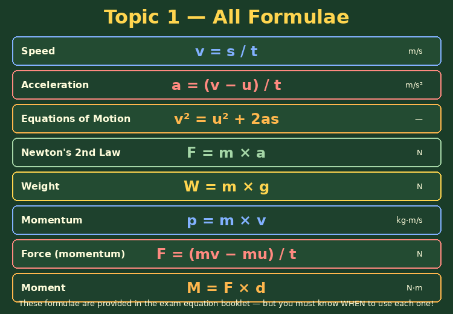

### Practice Questions — Test Yourself!

**1.** Calculate the speed of a car that travels 450 m in 30 s. **[2 marks]**

**2.** A bike accelerates from 5 m/s to 20 m/s in 3 s. Find the acceleration. **[2 marks]**

**3.** Find the distance a car travels while accelerating from 10 m/s to 30 m/s at 5 m/s². (Use v²=u²+2as) **[3 marks]**

**4.** A 60 kg student stands on the Moon (g = 1.6 N/kg). Calculate their weight. **[2 marks]**

**5.** A resultant force of 2400 N acts on an 800 kg car. Calculate the acceleration. **[2 marks]**

**6.** A car at 25 m/s has a reaction time of 0.8 s and braking distance of 40 m. Find the total stopping distance. **[2 marks]**

**7.** Explain why a skydiver reaches terminal velocity. **[6 marks]**

**8.** A 2 kg trolley at 3 m/s collides with a stationary 1 kg trolley. They stick together. Find the velocity after collision. **[3 marks]**

**9.** A force of 50 N acts 0.4 m from a pivot. Calculate the moment. **[2 marks]**

**10.** A uniform 2 m beam (weight 40 N) has a 100 N load at 0.5 m from the left end. Find the force at the right support. **[4 marks]**

**Total: 28 marks. Target: 22+ = Grade 8/9 standard.**
