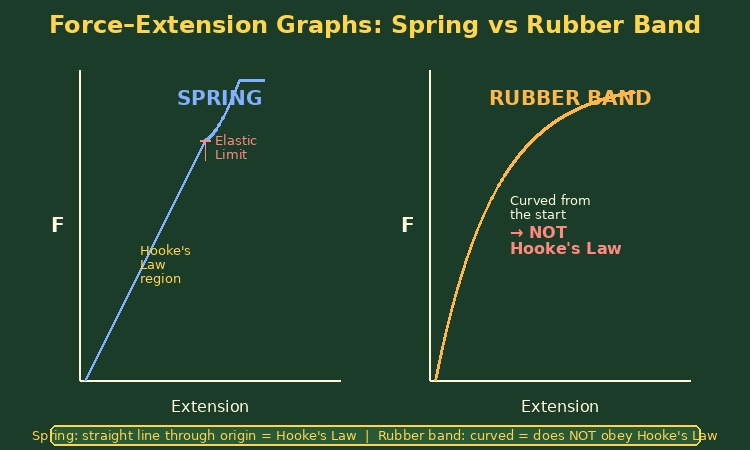

Key definition

<strong>Hooke's Law</strong> — Within the elastic limit, extension is directly proportional to the applied force. Graph: straight line through origin.

Key definition

<strong>Elastic Limit</strong> — The maximum force beyond which the material is permanently deformed and will NOT return to its original shape.

Key definition

<strong>Elastic Behaviour</strong> — The ability of a material to recover its original shape after the deforming forces are removed.

**Extension = New length − Original length (NOT the total length!).**

