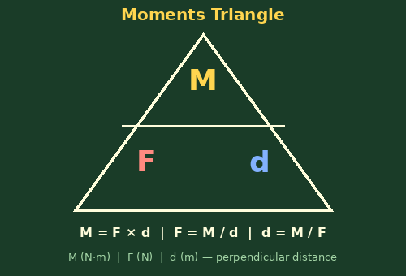
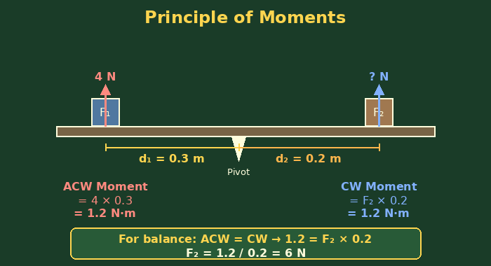

Formula

<strong>M = F × d     (Moment)</strong>

M = moment (N·m) | F = force (N) | d = perpendicular distance from pivot (m)

Key definition

<strong>Principle of Moments</strong> — For equilibrium: sum of clockwise moments = sum of anticlockwise moments about any point.

Key definition

<strong>Centre of Gravity</strong> — The point through which the entire weight of an object appears to act. For a uniform object, it is at the geometric centre.

WORKED EXAMPLE 6

<strong>Q: A 600 N child sits 2.5 m from a pivot. Where must a 750 N child sit to balance the seesaw?</strong>

ACW = 600 × 2.5 = 1500 N·m

CW = 750 × d = 1500 → d = 2.0 m

<strong>✅ The 750 N child sits 2.0 m from the pivot.</strong>

