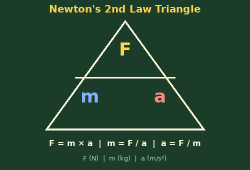
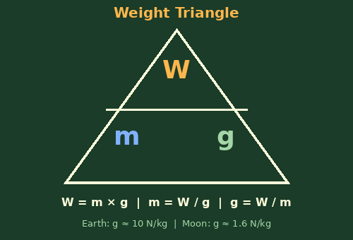
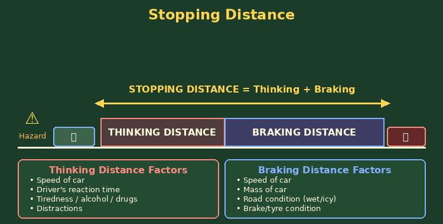

Formula

<strong>F = m × a     (Newton's Second Law)</strong>

F = resultant force (N) | m = mass (kg) | a = acceleration (m/s²)

Formula

<strong>W = m × g     (Weight)</strong>

W = weight (N) | m = mass (kg) | g = gravitational field strength (N/kg). Earth: g ≈ 10 N/kg

WORKED EXAMPLE 5

<strong>Q: A 1500 kg car has a resultant force of 4500 N. Find the acceleration.</strong>

a = F/m = 4500/1500

<strong>✅ a = 3 m/s²</strong>

### Stopping Distance (1.19–1.20)

Key definition

<strong>Stopping Distance</strong> — Total distance from seeing a hazard to stopping. = Thinking distance (speed × reaction time) + Braking distance.

**If speed DOUBLES: thinking distance doubles, but braking distance QUADRUPLES (because KE ∝ v²).**
