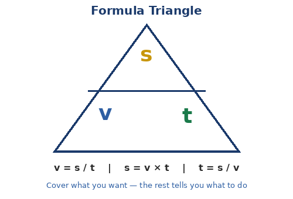
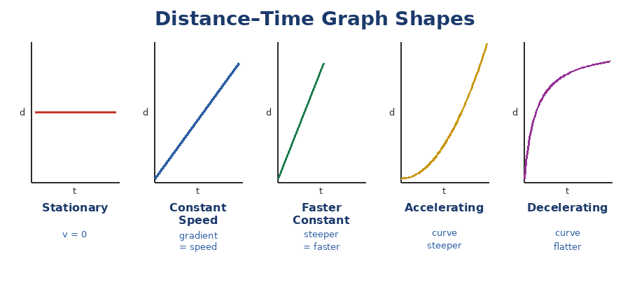
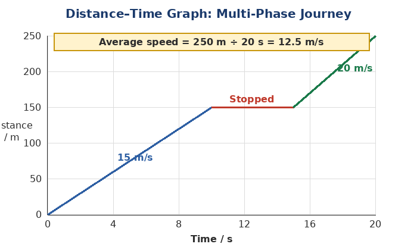

Key definition

<strong>Average Speed</strong> — The total distance moved divided by the total time taken. Formula: v = s/t. SI unit: m/s.

Formula

<strong>v = s / t</strong>

v = average speed (m/s)  |  s = distance (m)  |  t = time (s)

### Distance–Time Graphs

On a d–t graph, the GRADIENT (steepness) of the line tells you the SPEED of the object.

Key definition

<strong>Gradient of a d–t graph</strong> — The slope of the line = rise ÷ run = change in distance ÷ change in time = SPEED.

WORKED EXAMPLE 1

<strong>Q: A car travels 240 m in 12 s. Calculate its average speed.</strong>

v = s / t = 240 / 12

<strong>✅ Speed = 20 m/s</strong>

WORKED EXAMPLE 2

<strong>Q: A jogger runs 150 m in 10 s, rests for 5 s, then runs 100 m in 5 s. Find the average speed for the whole journey.</strong>

Total distance = 150 + 100 = 250 m

Total time = 10 + 5 + 5 = 20 s

v = 250 / 20

<strong>✅ Average speed = 12.5 m/s</strong>

### Practical: Investigating Motion (1.5)

Method: Set up ramp → mark distances → release toy car → time with stopwatch → repeat 3 times → calculate average speed → plot d–t graph.

Variables: Independent = distance. Dependent = time. Control = same car, same ramp height, same surface.

Improvement: Use light gates instead of stopwatch to remove human reaction time error.
