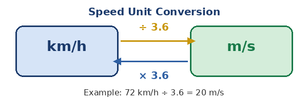

Physics uses the SI (Système International) system of units. Every measurement must include the correct unit. In Topic 1 you need these:

| **Physical Quantity** | **SI Unit** | **Symbol** | **Type** | **Spec** |
| --- | --- | --- | --- | --- |
| **Mass** | kilogram | kg | Base | 1.1 |
| **Length / Distance** | metre | m | Base | 1.1 |
| **Time** | second | s | Base | 1.1 |
| **Speed / Velocity** | metre per second | m/s | Derived | 1.1 |
| **Acceleration** | metre per second² | m/s² | Derived | 1.1 |
| **Force** | newton | N | Derived | 1.1 |
| **Gravitational field strength** | newton per kilogram | N/kg | Derived | 1.1 |
| **Moment (P only)** | newton metre | N·m | Derived | 1.2P |
| **Momentum (P only)** | kg metre/second | kg·m/s | Derived | 1.2P |

COMMON MISTAKES
<ul><li>Writing 'm' for miles — in physics m ALWAYS means metres.</li><li>Forgetting to convert km to m or hours to seconds BEFORE substituting into formulae.</li><li>Writing 'ms' (milliseconds) instead of 'm/s' (metres per second).</li></ul>

