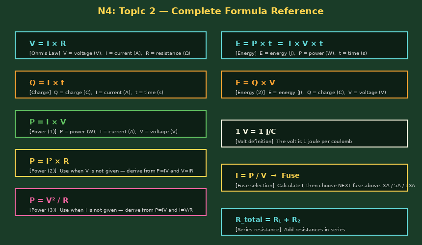

Fig N4: All Topic 2 formulae. Use the correct formula based on what quantities are given.

### Key Definitions — Spec Language

| **Term** | **Definition (use this exact language in exams)** |
| --- | --- |
| **Electric current** | The rate of flow of charge past a point in a circuit |
| **Voltage** | The energy transferred per unit charge passed (1V = 1J per coulomb) |
| **Resistance** | The ratio of voltage to current through a component (R = V/I) |
| **Power** | The rate of energy transfer (energy transferred per second) |
| **Ohm's Law** | Current is directly proportional to voltage (for constant temperature and resistance) |
| **AC** | Alternating current — direction of current reverses periodically |
| **DC** | Direct current — current always flows in the same direction |
| **Series circuit** | Circuit with one path for current; components connected end to end |
| **Parallel circuit** | Circuit with more than one path for current; components connected across the same two points |
| **LDR** | Light-dependent resistor — resistance decreases as light intensity increases |
| **NTC Thermistor** | Resistance decreases as temperature increases (NTC = Negative Temperature Coefficient) |
| **Static electricity** | A build-up of charge on an insulating material that does not flow |
| **Insulator** | A material through which charge cannot flow easily (all electrons tightly bound) |
| **Conductor** | A material through which charge flows easily (free electrons available) |
