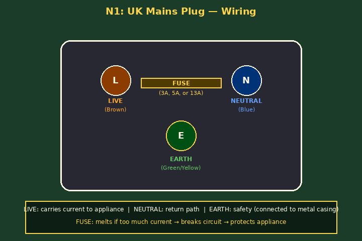

### The UK Mains Plug (Spec 2.2)

The standard UK mains plug has three wires, each with a specific colour and function:

LIVE (Brown): Carries the 230V alternating current to the appliance. The most dangerous wire.

NEUTRAL (Blue): Completes the circuit — carries current back from the appliance at ~0V.

EARTH (Green/Yellow): Connected to the metal casing of the appliance. Safety wire — only carries current if there is a fault.

FUSE: A thin wire in series with the live wire. Melts if current is too high → breaks the circuit → protects the appliance.

Fig N1: UK mains plug showing live (brown), neutral (blue), earth (green/yellow) wires and fuse.

### Protection Devices (Spec 2.2)

- Fuse: Thin wire that melts when current exceeds its rating — breaks circuit. Must be replaced after blowing.
- Circuit Breaker / MCB: Switch that automatically trips if current is too high. Can be reset — does not need replacing.
- Earth Wire: Provides a low-resistance path to earth if a fault makes the metal casing live — large current flows → fuse melts → circuit broken.
- Double Insulation: Appliance has an insulating plastic casing (no metal casing) so no earth wire is needed. Symbol: square inside a square.
- Insulation: Plastic covers on wires prevent accidental contact with live conductors.

| **❌ COMMON MISCONCEPTION** | **✅ THE TRUTH** |
| --- | --- |
| 'The earth wire stops you getting a shock' — it doesn't directly | The earth wire causes a large current → fuse melts → circuit breaks → appliance disconnected BEFORE you touch it. |
| The neutral wire is harmless | Neutral is at ~0V normally, but if it disconnects, the appliance casing could become live. The switch should always be in the LIVE wire. |

### AC vs DC (Spec 2.6)

- Alternating Current (a.c.): Direction of current reverses repeatedly. UK mains: 230V, 50Hz. Generated at power stations.
- Direct Current (d.c.): Current flows in one direction only. Supplied by cells and batteries. Used in most electronic devices.

### Power and Fuse Selection (Spec 2.3–2.5)

Why does current heat a resistor? Electrons collide with positive metal ions → transfer kinetic energy → ions vibrate more → temperature rises. Used in: kettle, toaster, iron, electric heater, filament bulb.

**P = I × V → Power (W) = Current (A) × Voltage (V)**

**I = P ÷ V → Rearranged for fuse selection**

**E = I × V × t → Energy (J) = Current × Voltage × Time (s)**

**FUSE SELECTION: Calculate I = P ÷ V, then choose the next standard fuse ABOVE that value.**

Available fuses: 3A  ·  5A  ·  13A

Example: 1200W hairdryer at 230V → I = 1200÷230 = 5.2A → choose 13A fuse (next above 5.2A).

Key fact

A fuse is always in SERIES with the LIVE wire — never the neutral

⭐  Choose a fuse ABOVE the operating current but as close as possible — a 13A fuse on a 60W lamp would not protect it

⭐  Energy in kWh: Power (kW) × Time (hours). Cost = kWh × price per unit

