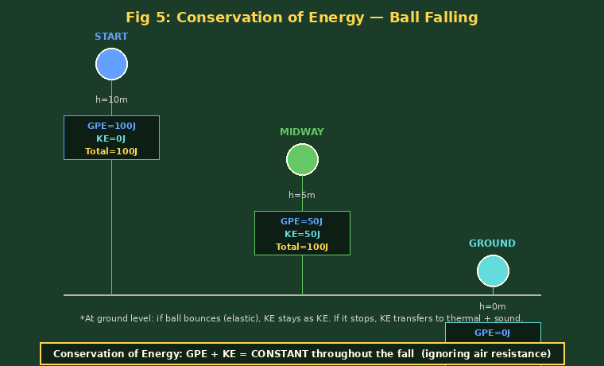
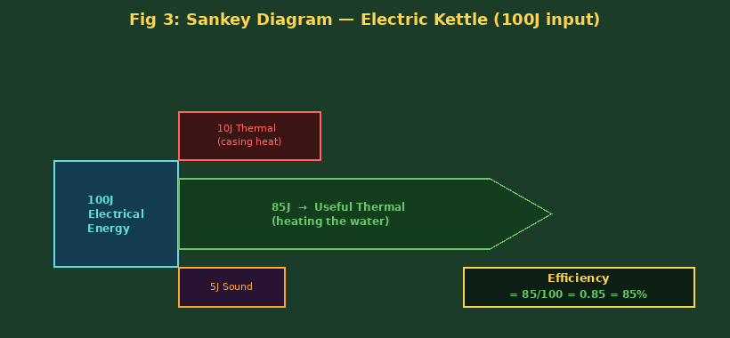
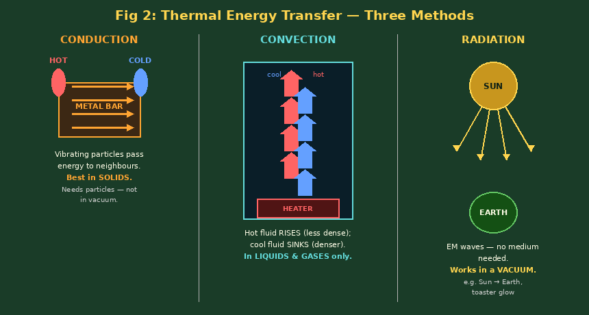
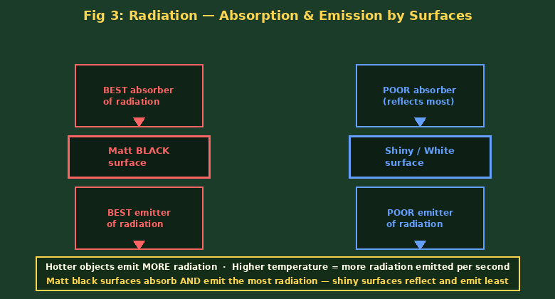
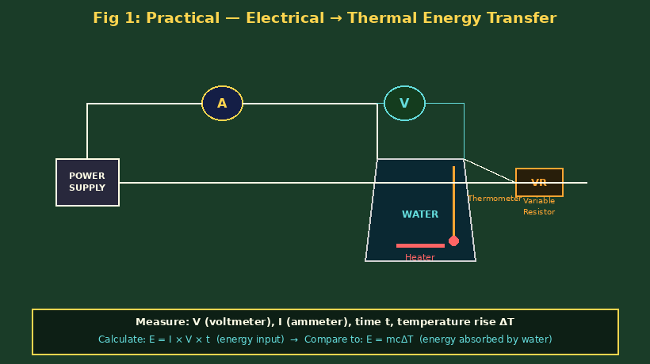

### Law of Conservation of Energy

📌 Spec 3.3

Key idea

<strong>Energy cannot be created or destroyed. It can only be transferred from one store to another.</strong>

The total energy of a closed system is always constant. When we say energy is "lost", we mean it has been transferred to the thermal store of the surroundings — it is NOT gone.

Fig B1: Conservation of energy during a falling ball. GPE + KE = constant at every point (ignoring air resistance).

### Efficiency

📌 Spec 3.4, 3.5

Formula

<strong>Efficiency = Useful Energy Output ÷ Total Energy Input     (as decimal, ×100 for %)</strong>

No machine is 100% efficient — energy is always dissipated (spread out into the surroundings as thermal energy). This is unavoidable due to friction, air resistance, and electrical resistance.

- Efficiency is between 0 and 1 (or 0% and 100%) — NEVER greater than 1
- To find wasted energy: Total input − Useful output = Wasted
- To find total input from efficiency: Total input = Useful output ÷ Efficiency

Fig B2: Sankey diagram for an electric kettle. Width of arrow ∝ energy. Useful output goes right; wasted outputs branch off.

**SANKEY DIAGRAMS: The width of each arrow represents the amount of energy. Useful output → right. Wasted outputs → branch up or down.**

| **❌  MISCONCEPTION** | **✅  TRUTH** |
| --- | --- |
| Efficiency > 1 is possible for heat pumps | Efficiency of a device cannot exceed 1.00 (100%). Any value above this means you have divided the wrong way round (swap numerator and denominator). |
| Wasted energy is lost forever | Wasted energy is transferred to the thermal store of the surroundings — it is never destroyed, just less useful. |

### Thermal Energy Transfer — Conduction

📌 Spec 3.6

CONDUCTION transfers thermal energy through SOLIDS. Vibrating particles collide with neighbours, passing energy along without the particles themselves moving.

- Best conductors: metals (copper, aluminium) — free electrons also carry energy
- Poor conductors (insulators): wood, plastic, glass, ceramic, air
- Denser, more closely packed particles → better conductor

### Thermal Energy Transfer — Convection

📌 Spec 3.6, 3.7

CONVECTION transfers thermal energy through LIQUIDS and GASES. Hot fluid becomes less dense, rises; cool fluid sinks. This sets up a convection current.

Fig B3: The three methods of thermal transfer. Conduction (solids), convection (fluids), radiation (no medium needed).

- Hot fluid → less dense → rises  \|  Cool fluid → more dense → sinks
- Creates a repeating CONVECTION CURRENT — the basis of all domestic heating systems
- Examples: household radiators, sea breeze, lava lamp, thermostat in a fridge

**Convection ONLY works in fluids (liquids and gases). It CANNOT occur in solids.**

### Thermal Energy Transfer — Radiation

📌 Spec 3.6, 3.8

RADIATION transfers thermal energy as INFRARED electromagnetic waves. It requires NO medium and can travel through a vacuum (e.g. Sun → Earth).

Fig B4: Radiation absorption and emission by surfaces. Matt black = best absorber AND emitter. Shiny/white = worst.

| **Surface type** | **Absorbs radiation?** | **Emits radiation?** | **Temperature** |
| --- | --- | --- | --- |
| Matt black (dark) | Best absorber | Best emitter | Gets hottest in sun |
| Shiny / white | Poor — reflects most | Poor emitter | Stays coolest |

- Hotter objects emit MORE radiation — and at shorter wavelengths
- ALL objects above absolute zero temperature emit some infrared radiation

### Reducing Unwanted Energy Transfer

📌 Spec 3.10

| **Method** | **How it works** | **Example** |
| --- | --- | --- |
| Loft insulation | Traps air — poor conductor — reduces conduction and convection | Fibreglass in roof space |
| Cavity wall insulation | Air/foam gap reduces conduction through walls | Double-brick with foam fill |
| Double glazing | Air/gas gap between glass panes | Argon gas between panes |
| Draught excluders | Block gaps — stop convection currents of cold air | Door seals, carpet underlay |
| Shiny surfaces | Reflect radiation — reduce emission and absorption | Survival blankets, thermos flask |

### Required Practical — Thermal Energy Transfer

📌 Spec 3.9P

AIM: Investigate how electrical energy transfers to thermal energy in a resistor/heater immersed in water.

Fig B5: Practical circuit. Ammeter (A) in SERIES with heater. Voltmeter (V) in PARALLEL across heater. Record V, I, time t, and temperature rise ΔT.

METHOD: Record V and I. Start stopwatch. After time t seconds, record ΔT.

**Calculate:  E input = I × V × t  (joules)  \|  Q absorbed = m × c × ΔT  where c = 4200 J/(kg·°C) for water**

EXPECT: E input > Q absorbed — some energy is lost to heating the container and surroundings.

| **Independent variable** | **Dependent variable** | **Control variables** |
| --- | --- | --- |

| **❌  MISCONCEPTION** | **✅  TRUTH** |
| --- | --- |
| E = mcΔT gives energy INPUT | mcΔT gives energy ABSORBED by the water — usually less than the electrical input (E=IVt) because some heat escapes to surroundings. |
