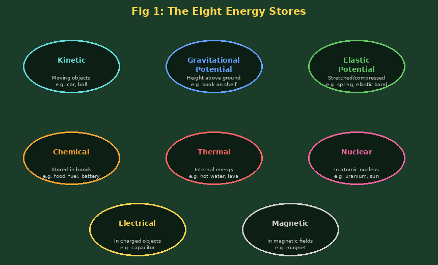
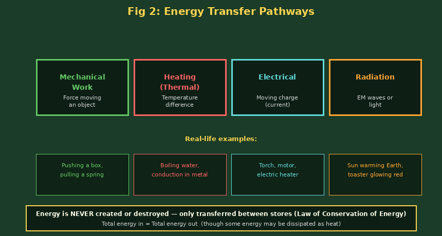
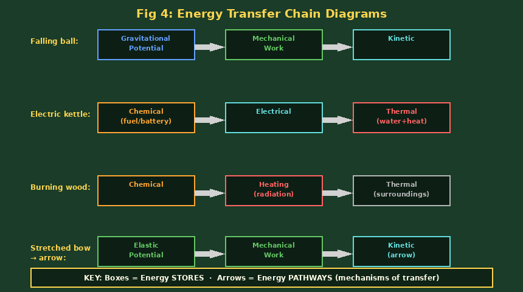

### Units Used in This Topic

| **Quantity** | **Unit** | **Symbol** | **Notes** |
| --- | --- | --- | --- |
| Mass | kilogram | kg | m in GPE=mgh, KE=½mv² |
| Energy | joule | J | All energy calculations |
| Distance | metre | m | d in W=Fd |
| Speed | m/s | m/s | v in KE=½mv² |
| Force | newton | N | F in W=Fd, P=Fv |
| Time | second | s | t in P=W/t |
| Power | watt | W | P=W/t  ·  1W=1J/s |
| Acceleration | m/s² | m/s² | Not directly in Topic 3 formulae |

### The Eight Energy Stores

📌 Spec 3.2

Energy is stored in objects and systems in 8 different ways. In every energy transfer, energy moves from one STORE to another via a PATHWAY.

Fig A1: The eight energy stores with examples. These must all be known for the exam.

| **Store** | **Description** | **Everyday example** |
| --- | --- | --- |
| Kinetic | Energy of moving objects | Moving car, spinning wind turbine |
| Gravitational Potential | Energy due to height above ground | Book on shelf, aircraft in flight |
| Elastic Potential | Energy in stretched or compressed objects | Stretched spring, drawn bow string |
| Chemical | Energy stored in chemical bonds | Food, fuel (petrol/gas), batteries |
| Thermal (Internal) | Energy of vibrating particles — heat | Boiling water, hot oven, lava |
| Nuclear | Energy stored in atomic nuclei | Uranium fuel, the Sun |
| Electrical | Energy of moving or stored charge | Charged capacitor |
| Magnetic | Energy stored in magnetic fields | Permanent magnet, compass needle |

### The Four Energy Transfer Pathways

📌 Spec 3.2

Pathways describe HOW energy moves between stores — NOT where it is stored. The distinction between stores and pathways is a common exam test.

Fig A2: The four energy transfer pathways. Boxes = stores; arrows = pathways. Radiation is a pathway, NOT a store.

| **Pathway** | **Real-life example** |
| --- | --- |
| Mechanical work | Pushing a box, lifting a weight |
| Heating | Conduction along a metal rod |
| Electrical | Current from battery to bulb |
| Radiation | Sunlight warming the Earth |

**IMPORTANT: Radiation (light, infrared, sound) is always a PATHWAY — never a store. Thermal is a STORE; heating is the PATHWAY.**

### Energy Transfer Chain Diagrams

📌 Spec 3.2

In chain diagrams: boxes = stores, arrows = pathways. Always label both. 'Wasted' energy usually ends up in the thermal store of the surroundings.

Fig A3: Energy transfer chains for four everyday scenarios. Note every arrow has a named pathway; every box has a named store.

| **❌  MISCONCEPTION** | **✅  TRUTH** |
| --- | --- |
| Radiation is an energy store like thermal | Radiation is an energy PATHWAY — a way energy travels. Thermal is the store; radiation is one mechanism for heating. |
| Energy is created when fuel burns | Energy is NEVER created. Chemical energy stored in fuel is transferred — it doesn't appear from nowhere. |
