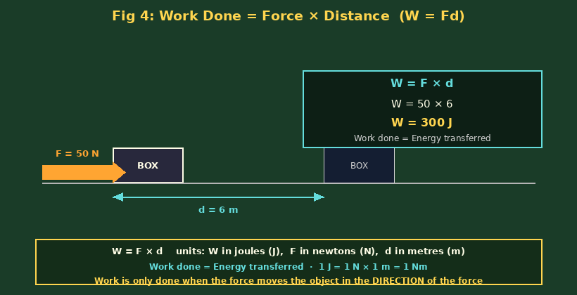
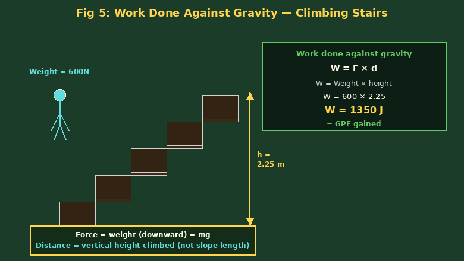
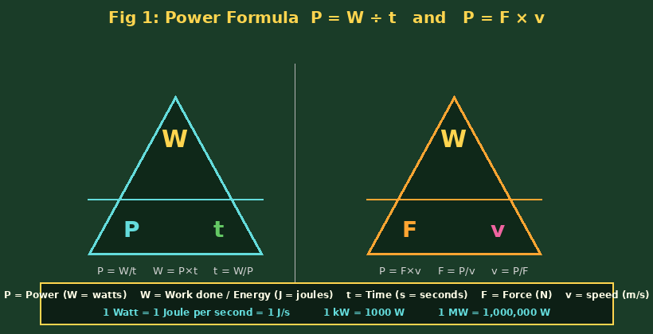
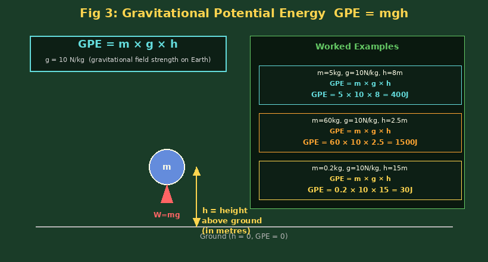
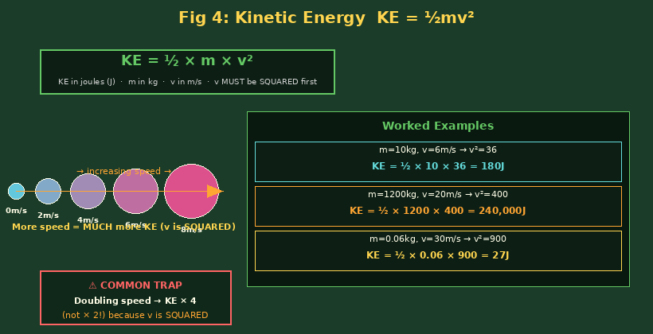
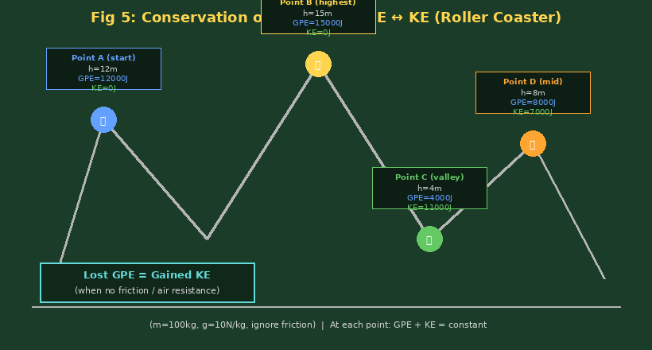

### Work Done W = Fd

📌 Spec 3.11, 3.12

Formula

<strong>W = F × d          W in joules (J)  ·  F in newtons (N)  ·  d in metres (m)</strong>

Work done = energy transferred. 1 joule of work is done when a force of 1 N moves an object 1 m in the direction of the force.

Fig C1: W = Fd. A 50N force moves a box 6m. W = 50 × 6 = 300J. Work done = energy transferred to the box.

- Work is ONLY done when the force moves the object in the DIRECTION of the force
- Carrying a bag horizontally: no work done against gravity (force ⊥ to horizontal motion)
- Lifting a box upward: W = weight × vertical height
- Against friction: work done = friction force × distance → all becomes thermal energy

Fig C2: Work done against gravity = weight × vertical height = mgh. Note: distance is VERTICAL height, not the length of the slope.

### Power P = W/t and P = Fv

📌 Spec 3.16, 3.17

Formula

<strong>P = W ÷ t     =     F × v          P in watts (W)  ·  W in joules  ·  t in seconds  ·  F in newtons  ·  v in m/s</strong>

Power = rate of energy transfer = rate of doing work. 1 watt = 1 joule per second.

DERIVATION of P = Fv:  P = W/t  →  W = Fd  →  P = Fd/t  →  d/t = v  →  P = Fv

Fig C3: Formula triangles for P=W/t and P=Fv. Cover the unknown to read off the formula.

| **Power value** | **Approximate real-world equivalent** |
| --- | --- |
| 1 W | LED torch or phone charger standby |
| 50–500 W | Human exercising (walking to sprinting) |
| 1 kW | Electric kettle or toaster |
| 50–150 kW | Small to medium car engine |
| 1 GW | Large power station (nuclear or coal) |

| **❌  MISCONCEPTION** | **✅  TRUTH** |
| --- | --- |
| More powerful = does more work | Power only tells you HOW FAST work is done. P = W/t → W = Pt. Same work at double power takes half the time — but the work done is the same. |
| Watts and joules are interchangeable | Watts (W) = power unit (J/s). Joules (J) = energy unit. They measure completely different things. |

### Gravitational Potential Energy GPE = mgh

📌 Spec 3.13

Formula

<strong>GPE = m × g × h          GPE in joules (J)  ·  m in kg  ·  g = 10 N/kg  ·  h in metres (m)</strong>

GPE is the energy stored by an object due to its height above a reference point (usually the ground). Use g = 10 N/kg unless told otherwise.

Fig C4: GPE = mgh with three worked examples. h is always the vertical height above the reference level.

- Doubling height → GPE doubles (directly proportional to h)
- Doubling mass → GPE doubles (directly proportional to m)
- At ground level: h = 0 → GPE = 0

### Kinetic Energy KE = ½mv²

📌 Spec 3.14

Formula

<strong>KE = ½ × m × v²          KE in joules (J)  ·  m in kg  ·  v in m/s  —  SQUARE v FIRST!</strong>

KE is the energy stored by a moving object. CRITICAL: v is squared — doubling speed QUADRUPLES KE (not doubles it).

Fig C5: KE = ½mv² with examples and the common trap box. Doubling speed → ×4 KE. This explains why speed is so dangerous in cars.

### Conservation of Energy: GPE ↔ KE

📌 Spec 3.15

Formula

<strong>When friction = 0:  GPE lost = KE gained  →  mgh = ½mv²  →  m cancels  →  v = √(2gh)</strong>

The speed of a freely falling object depends ONLY on h and g — NOT on mass. A feather and a hammer fall at the same speed in a vacuum.

Fig C6: Roller coaster — at any point, GPE + KE = constant (no friction). Use this to find speed at any height.

- v = √(2gh)  — derive by setting mgh = ½mv², cancel m, rearrange for v
- When friction present: GPE lost = KE gained + energy wasted as heat
- To find max height: set KE = GPE  →  h = KE ÷ (mg)

| **❌  MISCONCEPTION** | **✅  TRUTH** |
| --- | --- |
| Heavier objects fall faster | Mass cancels from mgh = ½mv². Speed depends only on height and g, NOT mass (in the absence of air resistance). |
| KE doubles when speed doubles | KE = ½mv². Doubling v → v² × 4 → KE × 4. This is why the stopping distance of a car is not proportional to speed — it is proportional to speed SQUARED. |

Key fact

v = √(2gh): find speed after falling height h from rest (friction-free)

⭐  GPE − KE = energy wasted by friction when ball/car does not gain full expected KE

⭐  g = 10 N/kg in all IGCSE calculations unless stated otherwise

