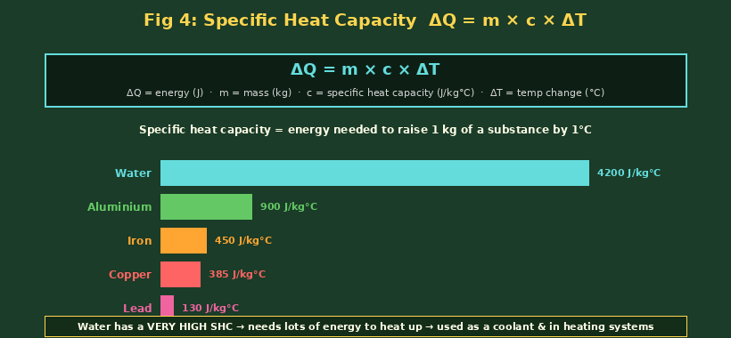
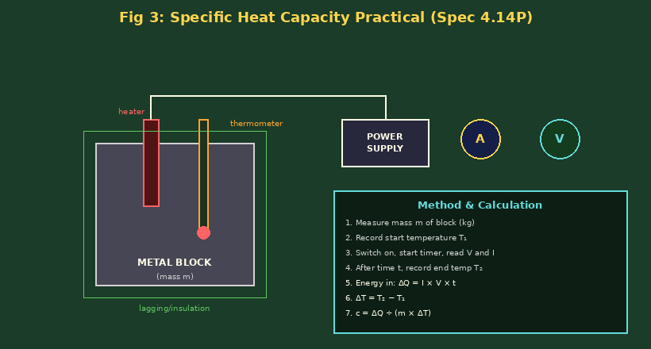
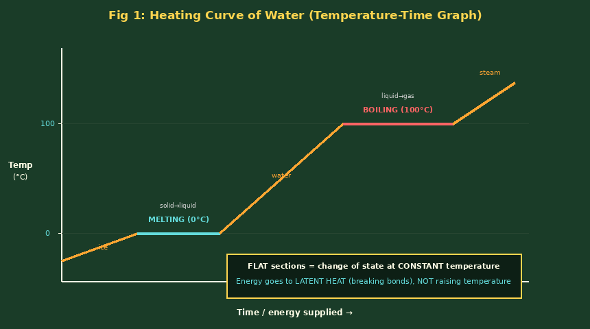
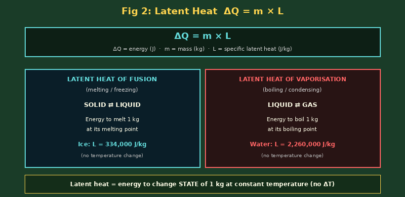
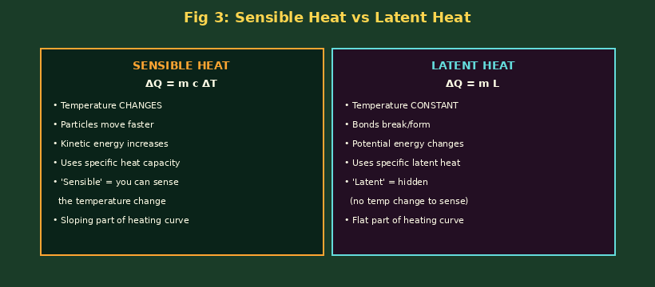

### Specific Heat Capacity ΔQ = mcΔT (Spec 4.12P, 4.13P)

Formula

<strong>ΔQ = m × c × ΔT          ΔQ (J)  ·  m (kg)  ·  c (J/kg°C)  ·  ΔT (°C)</strong>

**Specific heat capacity (c) = the energy needed to raise the temperature of 1 kg of a substance by 1°C.**

Fig C1: SHC comparison. Water (4200 J/kg°C) needs far more energy to heat than metals. This is why water is used as a coolant and coastal climates are mild.

### Required Practical — SHC (Spec 4.14P)

Fig C2: SHC practical. Heater warms an insulated block. Measure V, I, t, ΔT. Energy in ΔQ = IVt, then c = IVt ÷ (mΔT). Insulate to reduce heat loss.

The measured SHC is usually slightly HIGHER than the true value because some energy is lost heating the surroundings, not the block. Improve with insulation/lagging.

### Heating Curves (Spec 4.11P)

Fig C3: Heating curve of water. Sloping sections = temperature rising (sensible heat, mcΔT). Flat sections = change of state at constant temperature (latent heat, mL).

### Latent Heat ΔQ = mL (Spec 4.15P)

Formula

<strong>ΔQ = m × L          ΔQ (J)  ·  m (kg)  ·  L = specific latent heat (J/kg)</strong>

**Specific latent heat (L) = the energy needed to change the state of 1 kg of a substance WITHOUT a change in temperature.**

Fig C4: Latent heat of fusion (ice, 334,000 J/kg) and vaporisation (water, 2,260,000 J/kg). During both, all energy breaks bonds — temperature stays constant.

Fig C5: Sensible heat (ΔQ=mcΔT, temperature changes, sloping) vs latent heat (ΔQ=mL, temperature constant, flat).

| **Type of latent heat** | **State change** | **Value (water/ice)** |
| --- | --- | --- |
| **Fusion** | solid ↔ liquid | 334,000 J/kg |
| **Vaporisation** | liquid ↔ gas | 2,260,000 J/kg |

| **❌  MISCONCEPTION** | **✅  TRUTH** |
| --- | --- |
| Temperature rises during melting/boiling | Temperature stays CONSTANT — energy goes to breaking bonds (latent heat), not raising temperature. |
| SHC and latent heat are the same | SHC (J/kg°C) is for temperature change. Latent heat (J/kg) is for state change. Different quantities and units. |
| High SHC = heats up quickly | OPPOSITE — high SHC needs MORE energy per °C, so heats SLOWLY. Water (high SHC) heats slowly. |

Key fact

ρ=m/V · P=F/A · p=hρg · ΔQ=mcΔT · ΔQ=mL  — g=10 N/kg always

⭐  Convert g→kg and cm³→m³ before density calculations

⭐  Pressure in a liquid depends only on depth and density, not container shape

⭐  Temperature is constant during a change of state (latent heat)

⭐  Combined problems: use mcΔT for sloping parts and mL for flat parts, then add

