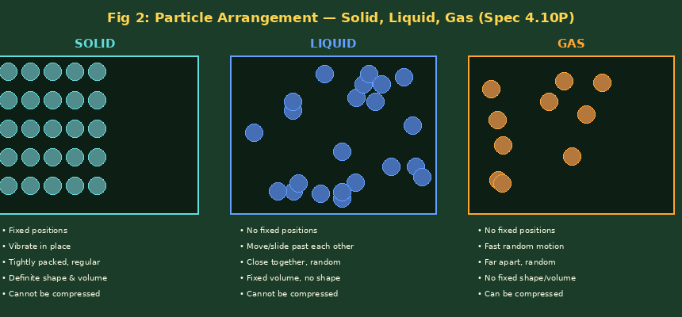
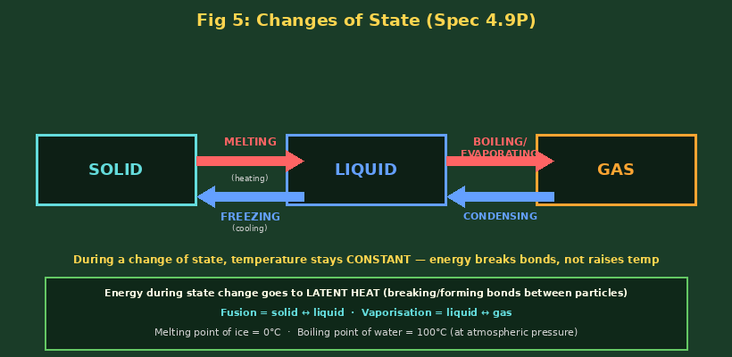
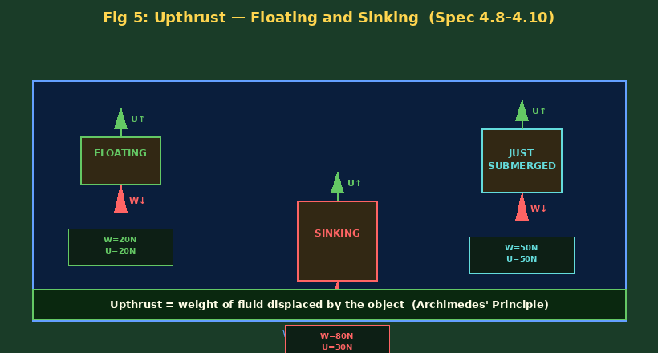
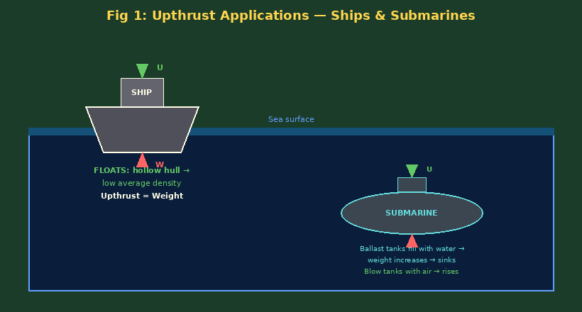

### Particle Model of Matter (Spec 4.10P)

Fig B1: Particle arrangement. Solid: regular, fixed, vibrating. Liquid: close, random, mobile. Gas: far apart, fast random motion, compressible.

| **Property** | **SOLID** | **LIQUID** | **GAS** |
| --- | --- | --- | --- |
| **Arrangement** | Regular, packed | Close, random | Far apart |
| **Movement** | Vibrate in place | Slide past each other | Fast, random |
| **Shape** | Fixed | Container shape | Fills container |
| **Volume** | Fixed | Fixed | Fills space |
| **Compressible** | No | No | Yes |

### Changes of State (Spec 4.9P)

Fig B2: Changes of state. Melting/boiling need energy (heating); freezing/condensing release energy (cooling). Temperature stays constant during a change of state.

### Upthrust, Floating & Sinking

Formula

<strong>Upthrust = weight of fluid displaced  (Archimedes' Principle)</strong>

Fig B3: FLOATING (U=W), SINKING (W>U), NEUTRAL (U=W submerged). Upthrust is the upward force from a fluid, equal to the weight of fluid displaced.

- FLOATING: upthrust = weight (net force zero)
- SINKING: weight > upthrust
- Apparent weight in fluid = real weight − upthrust
- Object floats if its average density &lt; fluid density

Fig B4: Ships float due to low average density (hollow hull). Submarines use ballast tanks — filling with water to sink, blowing out with air to rise.

| **❌  MISCONCEPTION** | **✅  TRUTH** |
| --- | --- |
| Upthrust only acts on floating objects | Upthrust acts on ALL objects in a fluid — even sinking ones. It just may be less than the weight. |
| Heavy objects always sink | Depends on DENSITY, not weight. A heavy ship floats; a small dense stone sinks. |
| Gas particles expand when heated | The particles stay the same size — they just move faster and spread further apart. |
