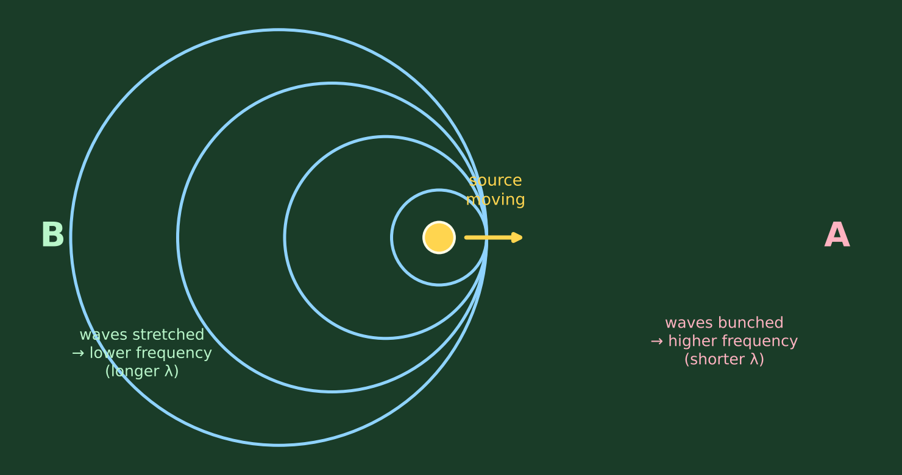

When a wave source moves relative to an observer, the observed frequency and wavelength change. This is the **Doppler effect**. As the source approaches, the wavefronts bunch up, so the observed wavelength is shorter and the frequency higher (higher pitch). As it moves away, the wavelength is longer and the frequency lower.

**The Doppler effect**

The source itself does not change its frequency — only the **observed** frequency changes. The red-shift of light from distant galaxies is a Doppler effect and is evidence that the Universe is expanding (the full red-shift calculation belongs to Topic 9).

Key facts

All waves — water, sound, light and the rest — can be <strong>reflected</strong> (bounce back, e.g. an echo) and <strong>refracted</strong> (change direction when they change speed).

