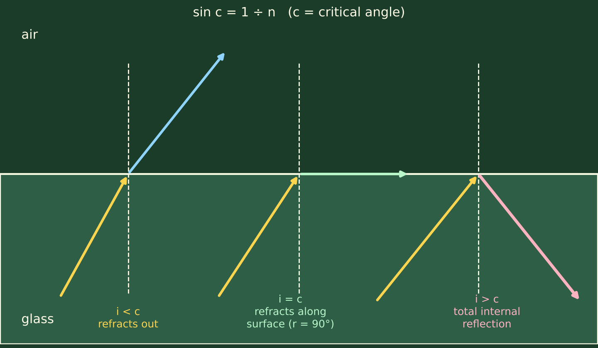
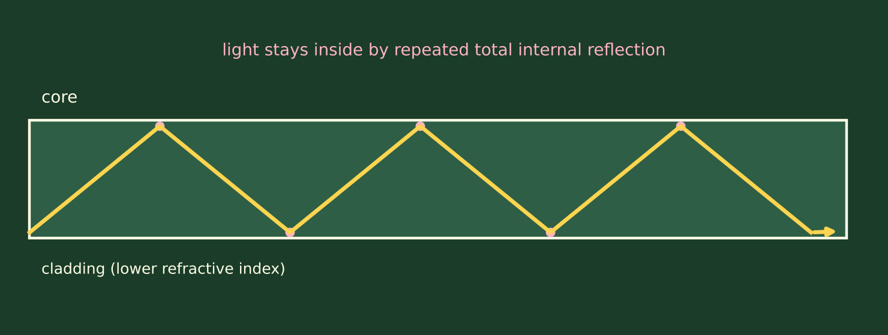

When light travels from a denser to a less dense medium and the angle of incidence is increased, the refracted ray bends further from the normal. At the critical angle c the refracted ray travels along the surface (r = 90°). Beyond c, no light escapes — it is all reflected back inside. This is total internal reflection (TIR).

**The critical angle and total internal reflection**

Formula

<strong>sin c = 1 ÷ n</strong>   (c = critical angle, n = refractive index of the denser medium)

**Two conditions for TIR:** (1) light going from a denser to a less dense medium (high → low refractive index); (2) angle of incidence greater than the critical angle.

**Uses of TIR:** optical fibres (communications and endoscopes) and prisms (periscopes, binoculars).

**Light travelling along an optical fibre by TIR**

**Worked example.** Glass of n = 1.52: sin c = 1 ÷ 1.52 = 0.658, so c = 41.1°.
