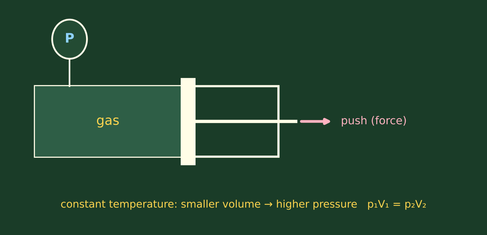

For a fixed mass of gas at constant temperature, pressure and volume are inversely proportional.

Formula

<strong>p₁V₁ = p₂V₂</strong>   (constant temperature; p and V in consistent units)

**Boyle's law apparatus (constant temperature)**

**Worked example.** A gas at 100 kPa in 40 cm³ is compressed to 20 cm³ at constant temperature. p₂ = p₁V₁ ÷ V₂ = 100 × 40 ÷ 20 = 200 kPa.

Key facts

Pressure law p₁/T₁ = p₂/T₂ needs kelvin. Boyle's law p₁V₁ = p₂V₂ needs constant temperature.Both are for a FIXED MASS of gas.

