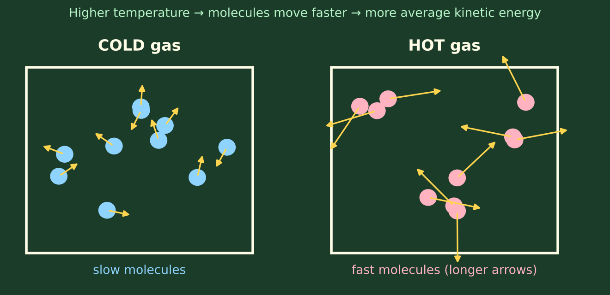

Heating a gas gives its molecules more energy, so they move faster on average. The Kelvin temperature of a gas is proportional to the average kinetic energy of its molecules: double the Kelvin temperature and the average kinetic energy doubles.

**Hotter gas = faster molecules with more kinetic energy**

Key facts

Higher temperature → faster molecules → more average kinetic energy.Average kinetic energy ∝ KELVIN temperature (not Celsius).The molecules do not change size when heated — they move faster.

