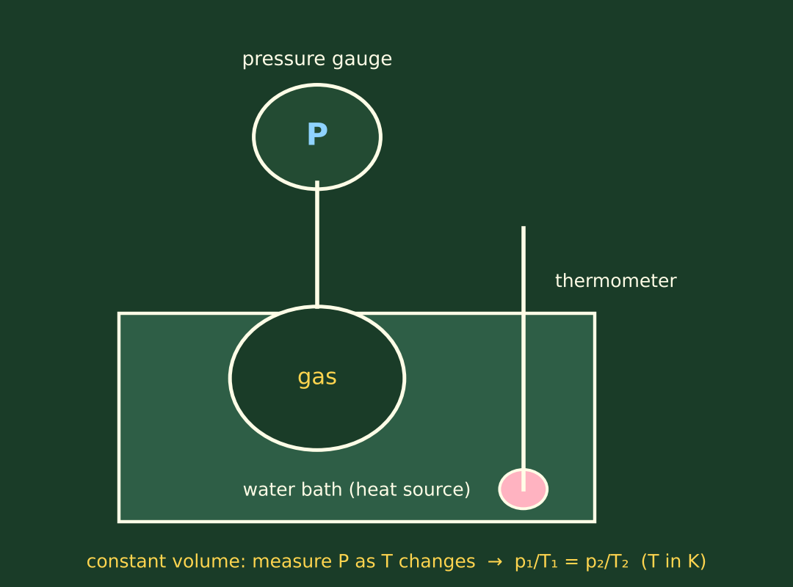

For a fixed mass of gas at constant volume, the pressure is proportional to the Kelvin temperature.

Formula

<strong>p₁ ÷ T₁ = p₂ ÷ T₂</strong>   (temperatures in kelvin)

**Pressure-law apparatus (constant volume)**

**Worked example.** A gas at 100 kPa and 300 K is heated to 600 K at constant volume. p₂ = p₁ × T₂ ÷ T₁ = 100 × 600 ÷ 300 = 200 kPa.

Common misconception

Using °C instead of kelvin. Always convert to kelvin first in any law that uses temperature.

