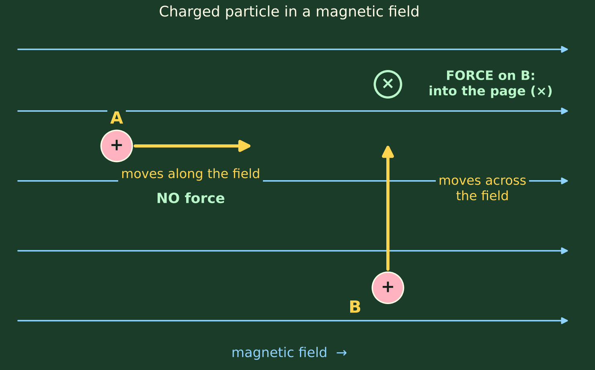
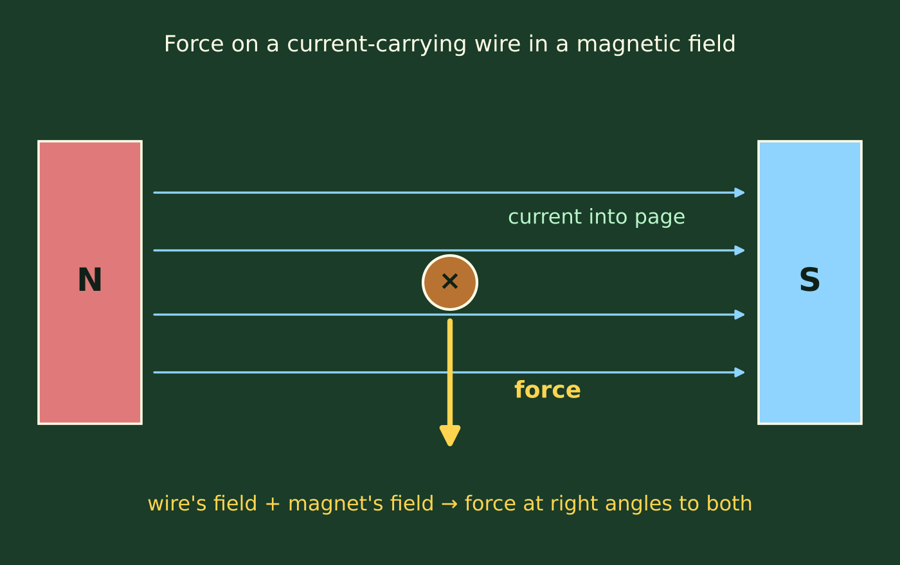
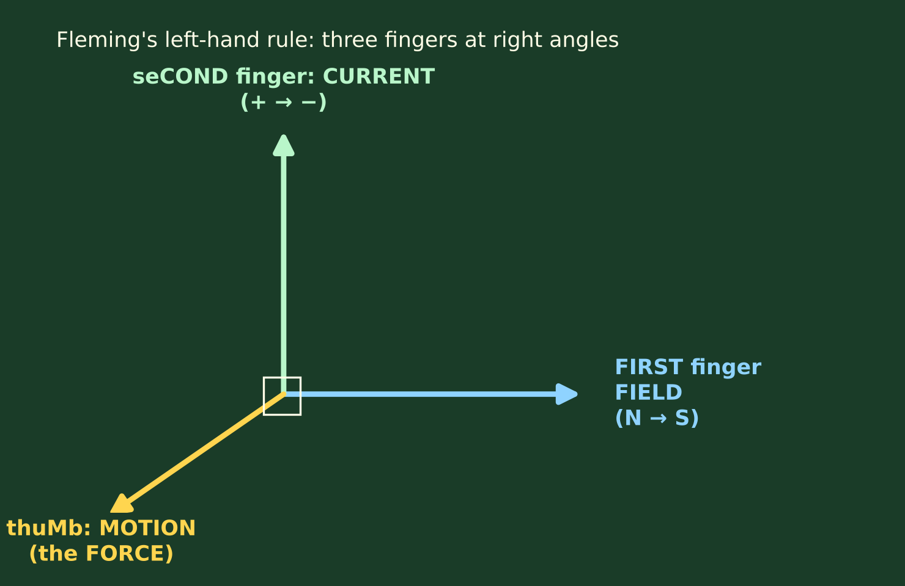
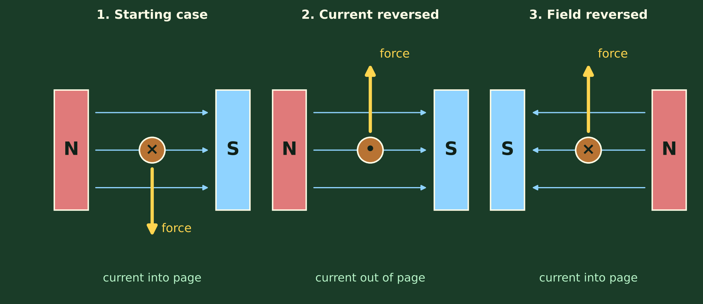
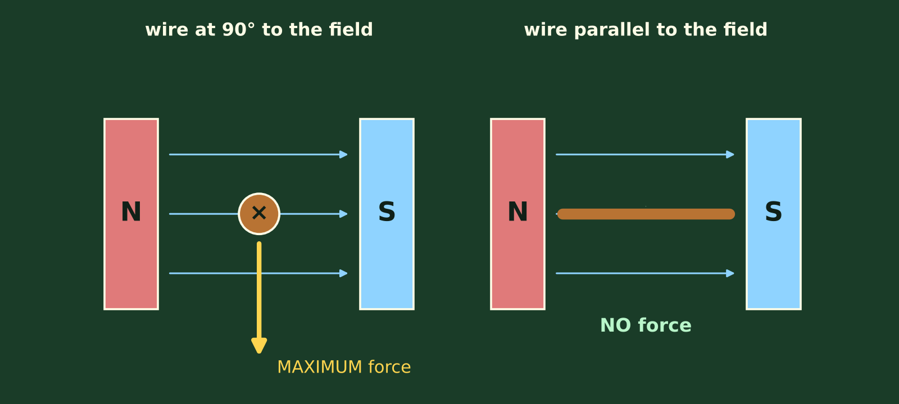
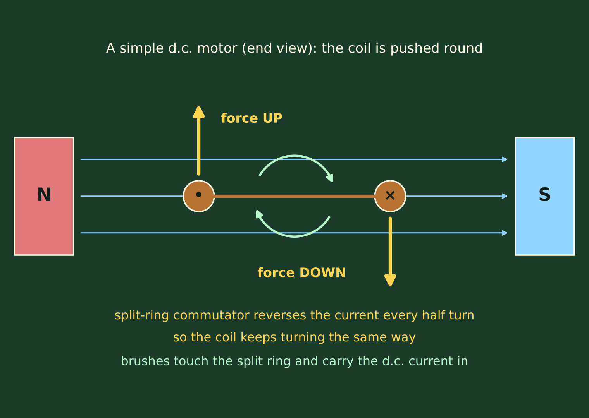
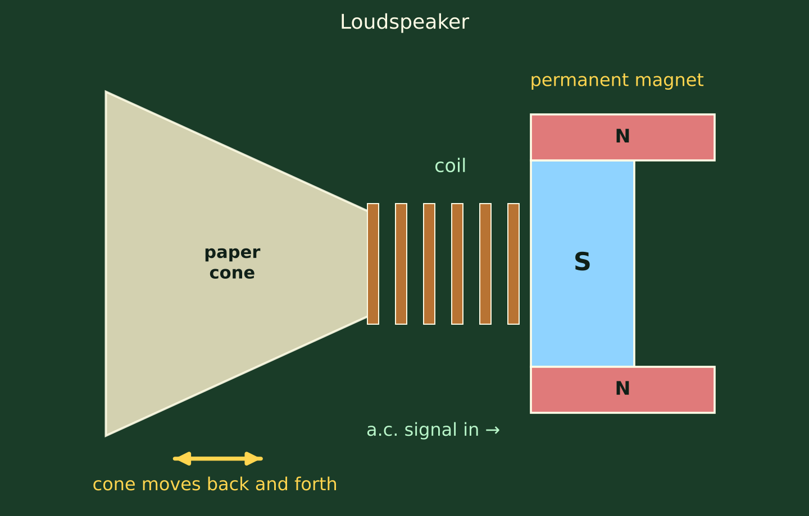

### Force on a moving charge (7.11P)

A charged particle moving through a magnetic field experiences a force **as long as its motion is not parallel to the field**. If it moves parallel to the field lines there is no force. The force acts at right angles to both the field and the motion.

*Figure 11: A moves along the field (no force); B moves across it (force)*

### Force on a current-carrying wire (7.12)

A wire carrying a current has its own magnetic field. In an external field the two fields interact and the wire feels a **force at right angles to both the current and the field**. This is the **motor effect**. A wire parallel to the field feels no force.

*Figure 12: the motor effect*

### The left-hand rule (7.13)

Fleming’s **left-hand rule** gives the direction of the force when the wire is at right angles to the field: **First finger = Field** (N → S), **seCond finger = Current** (+ → −), **thuMb = Motion** (the force). Use the left hand and conventional current.

*Figure 13: Fleming’s left-hand rule*

*Figure 14: reversing the current or the field reverses the force*

### What changes the force (7.14)

| **Change** | **Effect on the force** |
| --- | --- |
| Larger current | Larger force |
| Stronger magnetic field | Larger force |
| Reverse the current | Force reverses |
| Reverse the field | Force reverses |
| Reverse both | Force direction unchanged |
| Wire parallel to the field | No force |

*Figure 15: maximum force at 90°; none when parallel*

### The d.c. motor and the loudspeaker (7.12)

In a **d.c. motor** a coil sits in a magnetic field. The current flows in opposite directions along the two sides of the coil, so the forces are opposite and the coil turns. The **split-ring commutator** reverses the current every half turn so the coil keeps turning the same way; **brushes** carry the current in. A bigger current, stronger magnets or more turns make it spin faster.

*Figure 16: a simple d.c. motor*

In a **loudspeaker** a coil attached to a paper cone lies in the field of a permanent magnet. An **alternating current** in the coil makes the force reverse continuously, so the coil and cone vibrate and produce sound waves.

*Figure 17: a loudspeaker*

Key facts

No force on a charge or wire moving/lying parallel to the field. Force is at right angles to field and current.Left hand: F-C-M. Reverse current OR field → force reverses.Force increases with current and with field strength.Motor: coil + magnets + commutator + brushes. Loudspeaker: a.c. in coil in a magnetic field → cone vibrates.

Common Mistakes

Using the right hand, or using electron flow instead of conventional current.Saying both current and field reversed makes the force reverse. The two reversals cancel.Saying the commutator makes the motor spin. It reverses the current every half turn.Describing a loudspeaker as using d.c. It needs alternating current.

