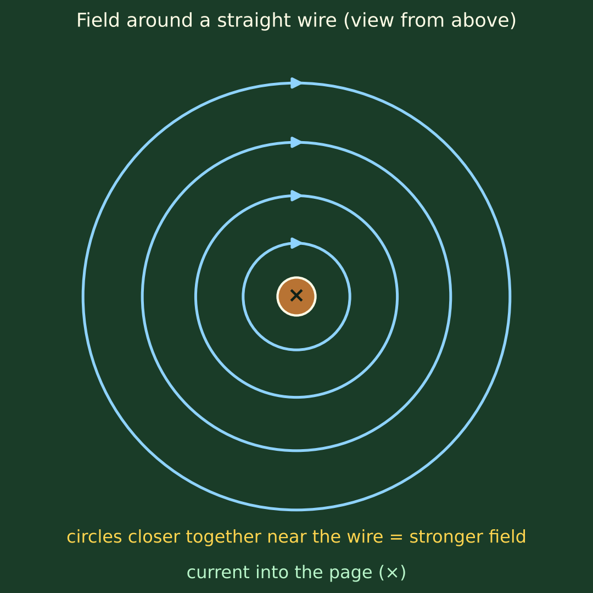
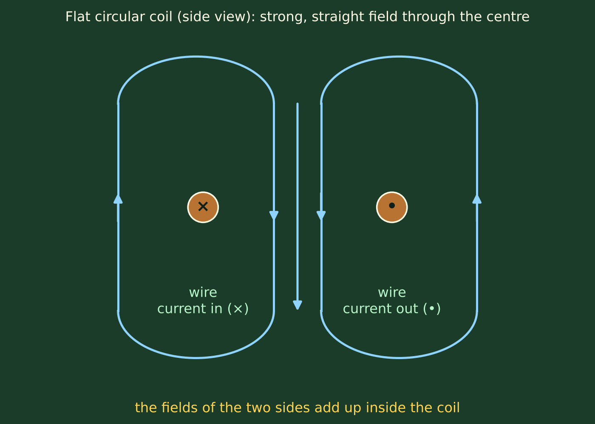
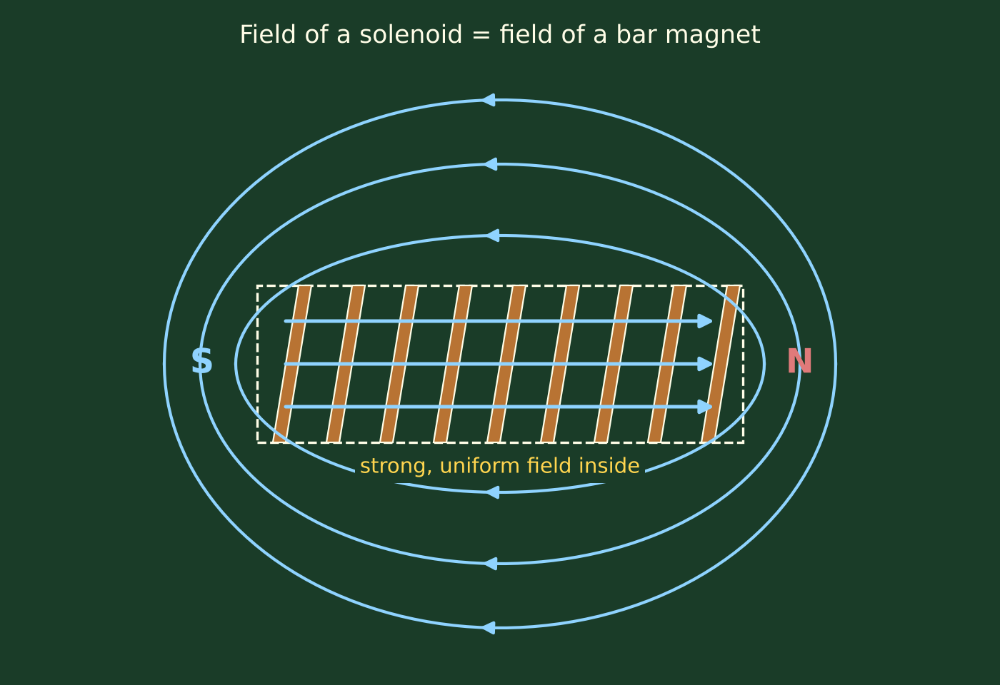
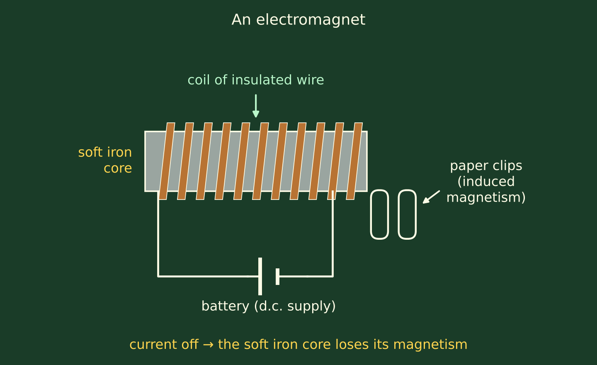

### A current produces a magnetic field (7.8)

There is a **magnetic field around any wire that carries an electric current.** Without a current there is no field. The field lines are **circles around the wire**, closer together near the wire, so the field is strongest close to it. It can be made stronger by increasing the current.

*Figure 7: the field around a straight wire*

### Coils and solenoids (7.10P)

A **flat circular coil** gives a strong, nearly straight field through its centre because the fields from all sides point the same way. A **solenoid** is a long coil: inside it the field is strong and uniform, and outside it the pattern is the same as a bar magnet, with a N pole at one end and a S pole at the other.

*Figure 8: the field through a flat circular coil*

*Figure 9: a solenoid has the field of a bar magnet*

### Electromagnets (7.9P)

An **electromagnet** is a solenoid wound on a **soft iron core**. It is built from a coil of insulated wire round a core of soft iron. It can be switched on and off, and its strength can be changed. It is made stronger by increasing the current, adding more turns, or using an iron core.

*Figure 10: an electromagnet*

Key facts

Common Mistakes

Saying the wire is a magnet or the field is there ‘because it is copper’. It is there because of the current.Drawing equally spaced circles. Spacing must increase with distance; draw at least four circles.Using steel for a core. Soft iron loses its magnetism when the current is switched off.

