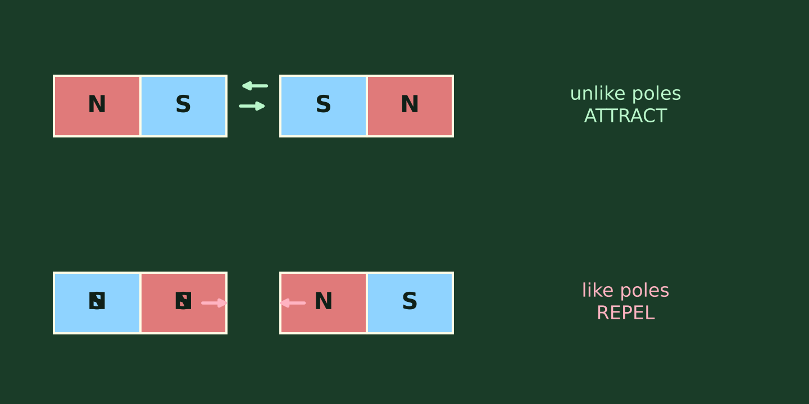
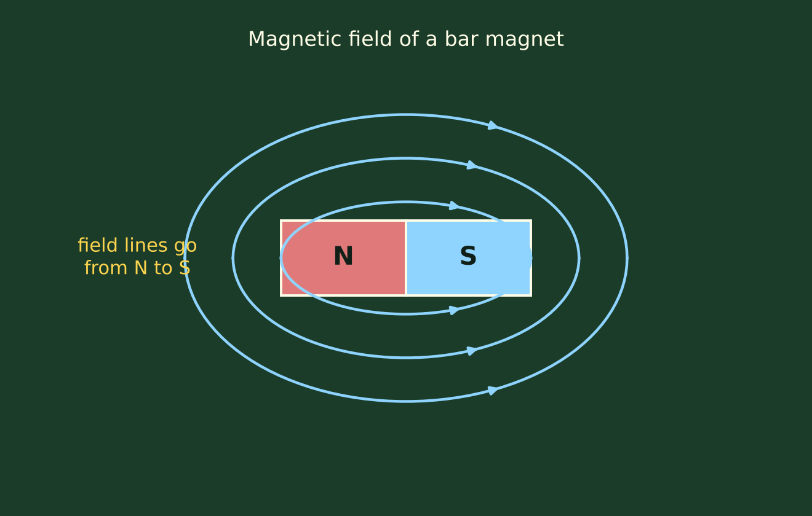
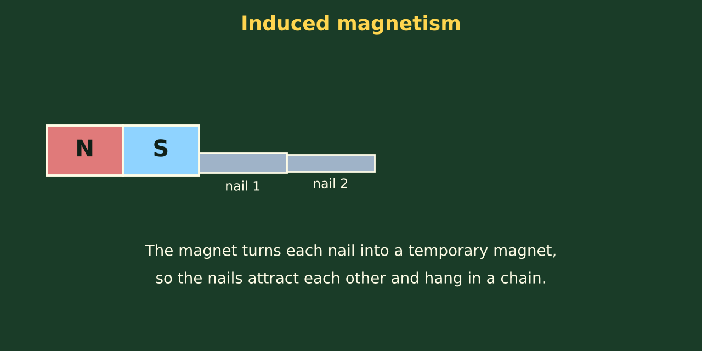
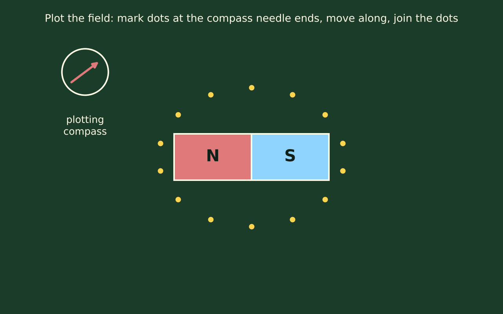
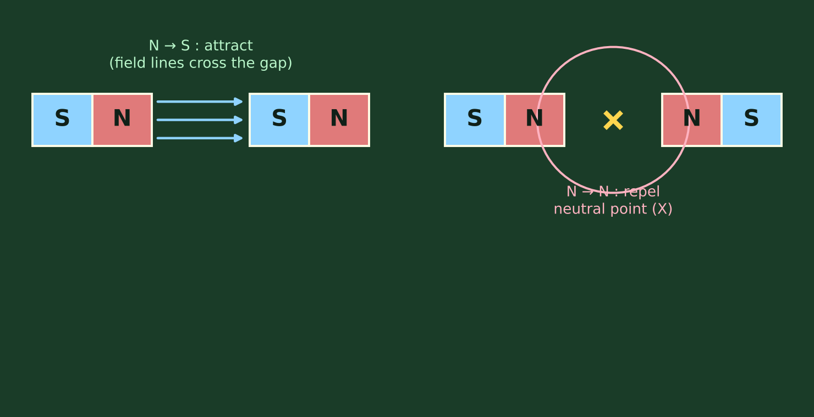
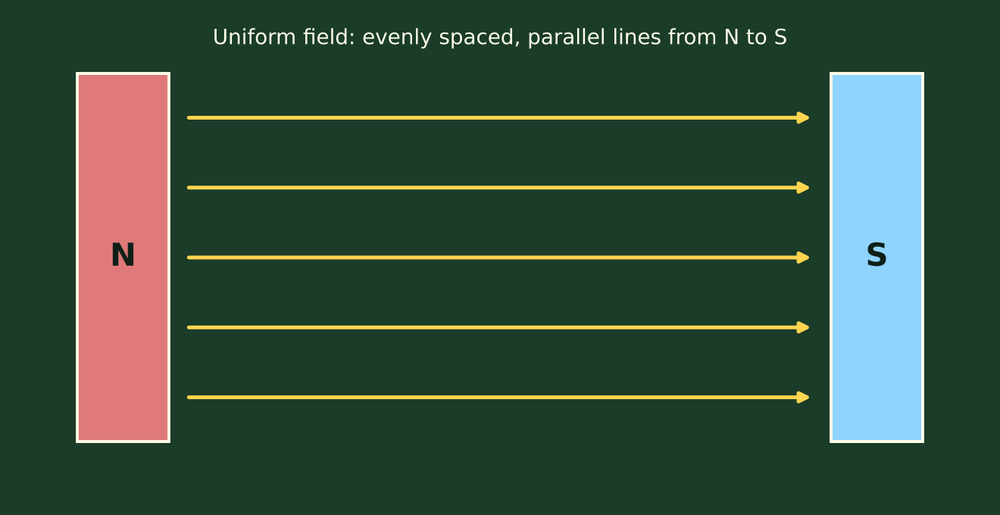

### Magnets, poles and magnetic materials (7.1, 7.2)

Every magnet has a north pole (N) and a south pole (S). **Like poles repel and unlike poles attract.** A magnet also attracts magnetic materials — iron, steel, nickel and cobalt — even though these are not magnets themselves. Copper, aluminium, plastic and wood are not attracted. The units used in this topic are the ampere (A) for current, the volt (V) for voltage and the watt (W) for power.

*Figure 1: like poles repel; unlike poles attract*

### Magnetically hard and soft materials (7.3)

| **Property** | **Magnetically HARD (e.g. steel)** | **Magnetically SOFT (e.g. iron)** |
| --- | --- | --- |
| Magnetising | Difficult to magnetise | Easy to magnetise |
| Keeping magnetism | Keeps its magnetism | Loses its magnetism easily |
| Used for | Permanent magnets | Electromagnet cores, transformer cores |

### Magnetic field lines (7.4)

A **magnetic field** is the region around a magnet where it exerts a force on magnetic materials. We draw it with **field lines**. The lines show the **shape**, the **direction** and the **strength** of the field. Outside a magnet they run from N to S, they never cross, and the field is stronger where the lines are closer together — at the poles.

*Figure 2: field lines of a bar magnet run from N to S*

### Induced magnetism (7.5)

A magnetic material placed in a magnetic field becomes a magnet itself — this is **induced magnetism**. A soft iron nail near a magnet becomes magnetised, attracts a second nail, and loses its magnetism when the magnet is removed. The nail is always attracted to the magnet.

*Figure 3: induced magnetism — a chain of nails*

### Plotting fields — required practical (7.6)

- **Plotting compass:** place the bar magnet on paper, draw round it. Put the compass near the N pole and mark the needle ends. Move the compass so the tail lies on the last dot and repeat, then join the dots and add an arrow (N → S). Repeat from different starting points.
- **Iron filings:** lay a card over the magnet, sprinkle filings and tap gently. They show the **shape** but not the **direction**.
- **Between two magnets:** unlike poles facing give lines straight across the gap (attraction). Like poles facing give lines that curve away, with a **neutral point** where the field is zero.

*Figure 4: plotting a field line with a compass*

*Figure 5: the field between two magnets*

### A uniform field (7.7)

A uniform field has the same strength and direction everywhere. Put a N pole facing a S pole a short distance apart: between them the field lines are **parallel and equally spaced**, pointing from N to S.

*Figure 6: a uniform field between two opposite poles*

Key facts

Like poles repel; unlike poles attract. Magnets attract iron, steel, nickel and cobalt.Hard = keeps magnetism (permanent magnets). Soft = loses it (cores).Field lines: N → S outside the magnet, never cross, closer = stronger.Compass shows direction; iron filings show only shape. Uniform field = parallel, equally spaced lines.

Common Mistakes

Writing ‘like poles attract’. They repel.Saying iron filings show the field direction. A compass is needed for the arrows.Drawing field lines that cross or have no arrows.Defining ‘hard’ with an example only. The mark is for ‘keeps its magnetism’.

