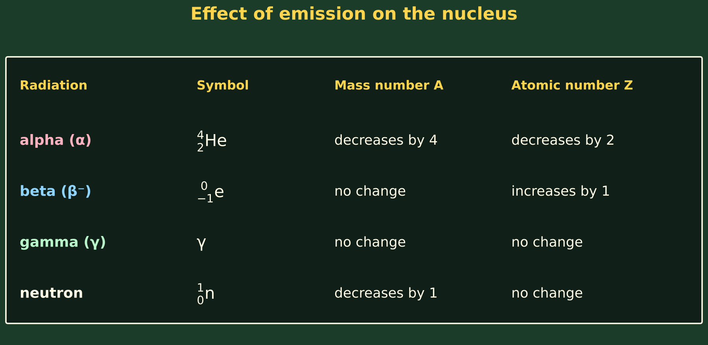
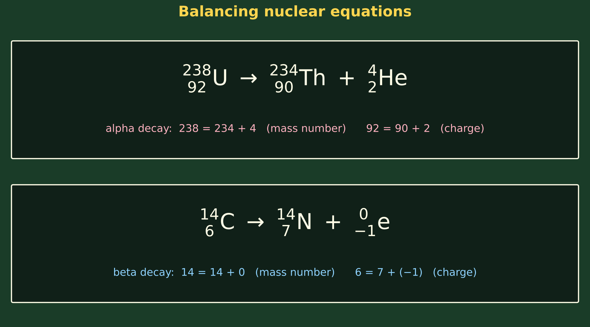

### What each emission does to the nucleus (8.7)

*Figure 9: effect of each emission on A and Z*

### Balancing nuclear equations (8.8)

Balance **mass** (top numbers) and **charge** (bottom numbers): the totals on the left must equal the totals on the right.

*Figure 10: alpha and beta decay equations*

| **Level** | **Question** | **Full working (write it all on the board)** | **Answer** |
| --- | --- | --- | --- |
| Easy | ²²⁶₈₈Ra → ²²²₈₆Rn + ? | 226 = 222 + 4; 88 = 86 + 2 | ⁴₂He (alpha) |
| Medium | ²⁴₁₁Na → ²⁴₁₂Mg + ? | 24 = 24 + 0; 11 = 12 + (−1) | ⁰₋₁e (beta) |
| Hard | ²³⁴₉₀Th → ²³⁴ₓPa + ⁰₋₁e. Find x. | 90 = x + (−1) | x = 91 |

Key facts

Common Mistakes

Changing A in beta decay. A stays the same; Z goes up by 1.Writing the electron’s charge as +1.Forgetting to write the element symbol after finding Z (use the periodic table).

Exam Tips

For a 3-mark equation: correct element symbol (1), correct mass numbers (1), correct charges (1).Show the check: 90 = 90 + 0 and 39 = 40 + (−1).

