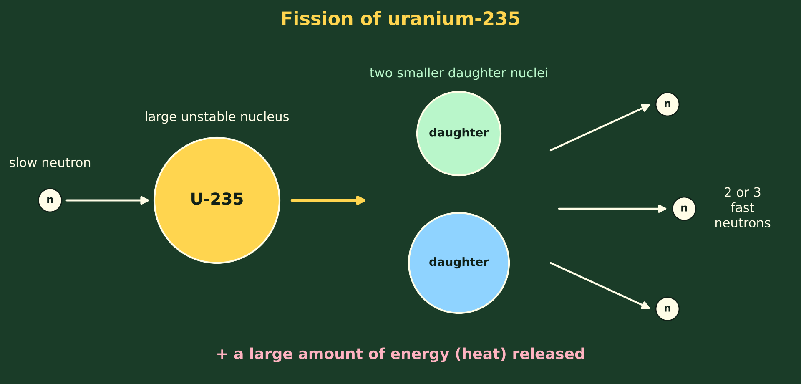
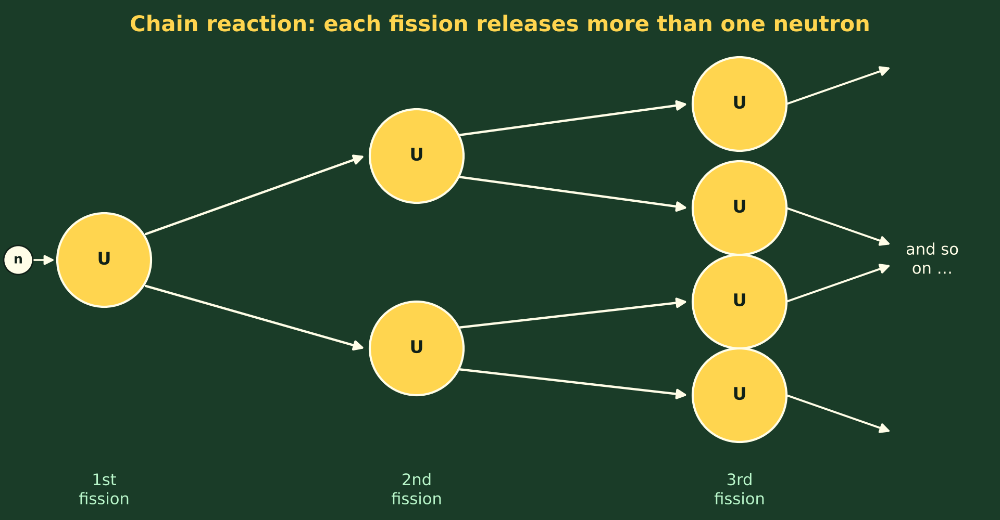
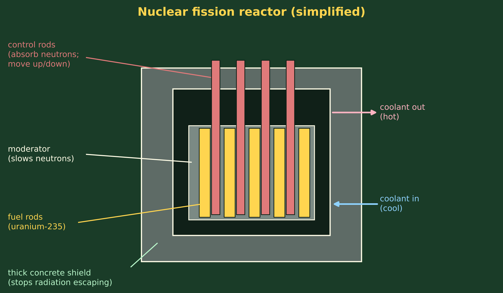

### Fission of U-235 (8.17–8.19)

Nuclear reactions — fission, fusion and radioactive decay — can all be a source of energy. In **fission** a **neutron** hits a **U-235** nucleus, which splits into **two radioactive daughter nuclei** plus **two or three neutrons**, and releases energy as the **kinetic energy of the fission products**.

*Figure 16: fission of uranium-235*

### Chain reaction (8.20)

The neutrons from one fission strike other U-235 nuclei and split them. If each fission causes **more than one** further fission, the rate increases rapidly — an **uncontrolled** chain reaction.

*Figure 17: a chain reaction*

### The reactor (8.21, 8.22)

| **Part** | **Job** | **Effect on rate of fission** |
| --- | --- | --- |
| Fuel rods | contain U-235 | source of fission |
| Moderator | slows neutrons | increases it (slow neutrons are absorbed more easily) |
| Control rods | absorb neutrons | decrease it; moving them keeps the rate constant |
| Coolant | takes heat from the core | heat used to make steam |
| Concrete shield | absorbs radiation | protects workers and the environment |

*Figure 18: a nuclear fission reactor*

Key facts

Fission: neutron + U-235 → 2 daughter nuclei + 2 or 3 neutrons + energy.Chain reaction: neutrons from one fission cause further fissions. More than one each = uncontrolled.Moderator slows neutrons. Control rods absorb neutrons. Concrete shield absorbs radiation.

Common Mistakes

Saying control rods slow neutrons down (that is the moderator).Defining a chain reaction without neutrons.Writing risks of a meltdown when the question asks about waste.

