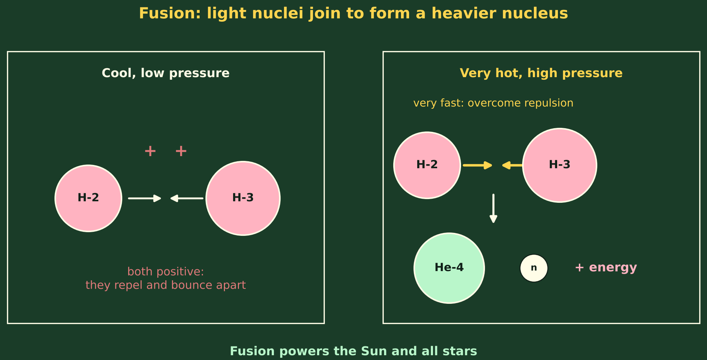

### What is fusion? (8.23–8.25)

In **fusion**, **small nuclei join** to form a **larger nucleus**. The mass of the new nucleus is **less** than the total mass of the nuclei that joined, and the **loss of mass** is accompanied by a **release of energy**. Fusion is the **energy source for stars**, including the Sun, where hydrogen nuclei fuse to form helium. Example: ²₁H + ³₁H → ⁴₂He + ¹₀n + energy.

|   | **Fission** | **Fusion** |
| --- | --- | --- |
| What happens | a large nucleus splits into smaller nuclei | small nuclei join to form a larger nucleus |
| Needs | a neutron | very high temperature and pressure |
| Used | nuclear power stations | stars (not yet a power source on Earth) |

### Why fusion needs high temperature and pressure (8.26)

*Figure 19: fusion and why it needs very high temperature*

Key facts

Fusion: small nuclei join → larger nucleus; mass lost; energy released; powers stars.Nuclei are positive and repel: high temperature and pressure needed to overcome the repulsion.

Common Mistakes

Exam Tips

‘Explain the difference’: give both sides (fission splits large nuclei; fusion joins small ones).Use the words ‘positive’, ‘repel’ and ‘overcome’ for any question on why fusion is hard.For a six-mark reactor answer, write three linked chains: control rods → absorb neutrons → rate falls; moderator → slows neutrons → rate rises; moving the rods → rate constant.

