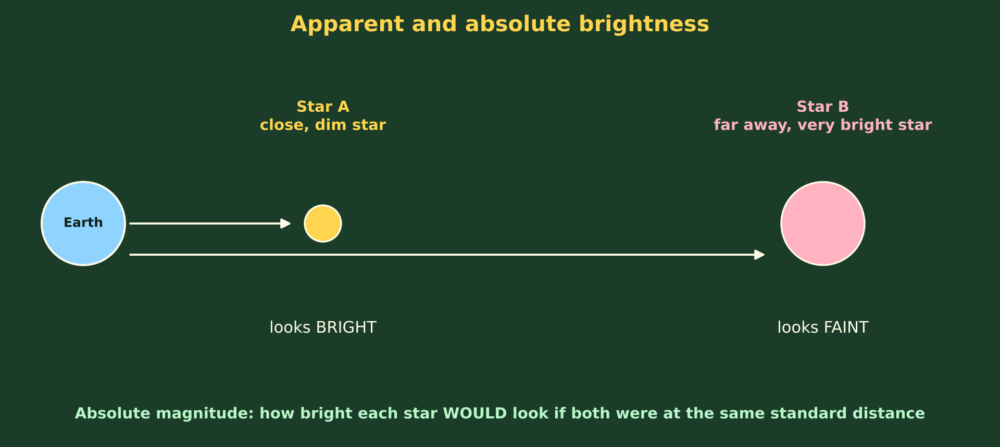
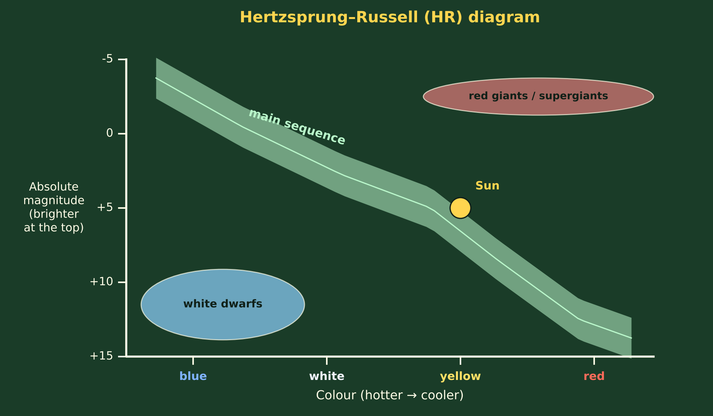
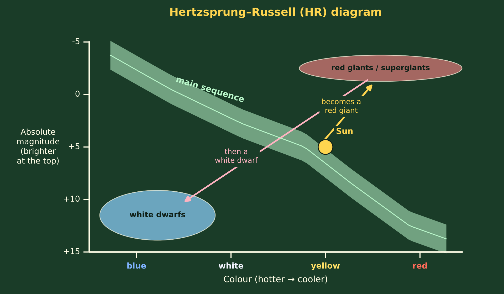

### Absolute magnitude (9.11P)

How bright a star **appears** depends on how far away it is, so apparent brightness is not a fair comparison. **Absolute magnitude** is the brightness a star would have at a **standard distance** (10 parsecs, about 32.6 light-years). It lets astronomers compare stars fairly. **The smaller (more negative) the magnitude, the brighter the star.**

*Figure 10: distance changes apparent brightness; absolute magnitude uses a standard distance*

### The Hertzsprung–Russell diagram (9.12P)

The **HR diagram** plots **absolute magnitude** (vertical axis, −5 at the top to +15 at the bottom) against **colour or temperature** (horizontal axis, blue on the left to red on the right). Stars fall into groups:

**Main sequence:** the diagonal band from top left to bottom right — most stars, including the Sun (yellow, about +5). **Red giants and supergiants:** top right — cool (red) but very bright because they are huge. **White dwarfs:** bottom left — hot (white) but dim because they are tiny.

*Figure 11: the HR diagram — main components*

A star’s position shows its stage: a Sun-like star starts on the main sequence, moves **up and right** to become a red giant, then **down to the bottom left** as a white dwarf.

*Figure 12: the path of a Sun-like star on the HR diagram*

Key facts

Common Mistakes

Putting the brightest stars at the bottom of the diagram.Drawing the main sequence bottom-left to top-right.Mixing up apparent brightness (as seen from Earth) with absolute magnitude (standard distance).Writing several letters in the shape on the diagram question: one letter only.

