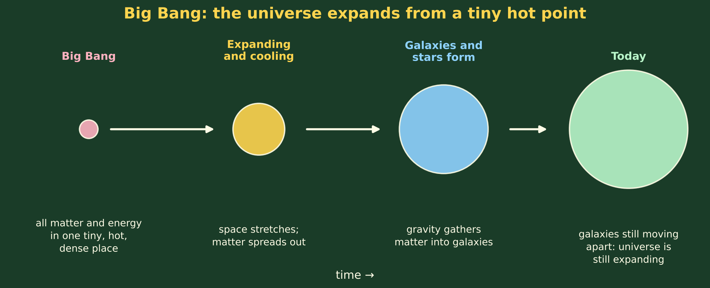
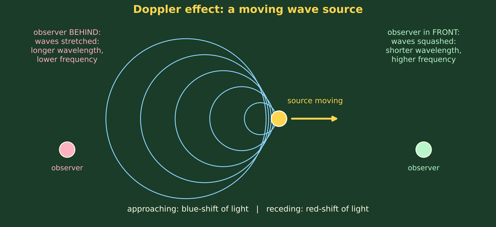
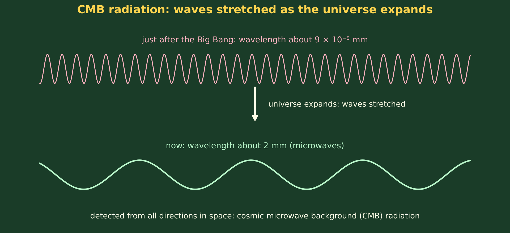

### The Big Bang theory (9.13P)

The **Big Bang theory** says that the universe began about 13.8 billion years ago from a **single, tiny, hot, dense place**. Space has been **expanding** ever since. The universe **cooled** as it expanded, and gravity gathered matter into **stars and galaxies**. It is still expanding.

*Figure 13: the Big Bang and the expanding universe*

### The Doppler effect (9.15P)

When a **wave source moves relative to an observer**, the **observed frequency and wavelength change**. A source moving **towards** the observer: waves squashed, **shorter wavelength, higher frequency**. A source moving **away**: waves stretched, **longer wavelength, lower frequency**. For light, moving towards gives **blue-shift** and moving away gives **red-shift**.

*Figure 14: the Doppler effect for a moving source*

### Evidence for the Big Bang (9.14P)

**1. Cosmic microwave background (CMB) radiation:** microwaves arriving from **all directions**, the **afterglow of the Big Bang**. When released it had a very short wavelength (about 9 × 10⁻⁵ mm); as space expanded the wavelength was **stretched** to about 2 mm today. **2. Red-shift of galaxies:** light from galaxies is shifted to longer wavelengths because they are moving away.

*Figure 15: CMB wavelength stretched as the universe expanded*

Method

CMB wavelength: λ = v ÷ f = 3.0 × 10⁸ ÷ 1.6 × 10¹¹ = 1.9 × 10⁻³ m = <strong>1.9 mm</strong>.

Key facts

Big Bang: everything began in one tiny, hot, dense place; the universe has expanded and cooled since.Towards the observer → shorter λ, higher f (blue-shift). Away → longer λ, lower f (red-shift).Two pieces of evidence: CMB radiation and red-shift of galaxies.CMB wavelength has increased because the universe is expanding.

Common Mistakes

Saying the Big Bang happened at one point in space — space itself expanded.Saying the source’s own frequency changes in the Doppler effect — the observed frequency changes.Writing ‘red-shift’ for the CMB explanation. The mark is for ‘the wavelength has increased because the universe is expanding’.

