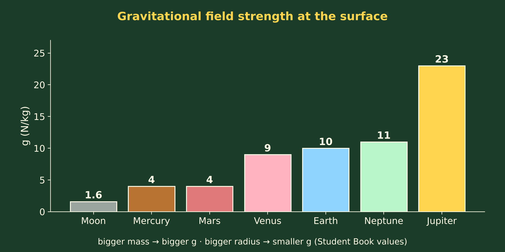
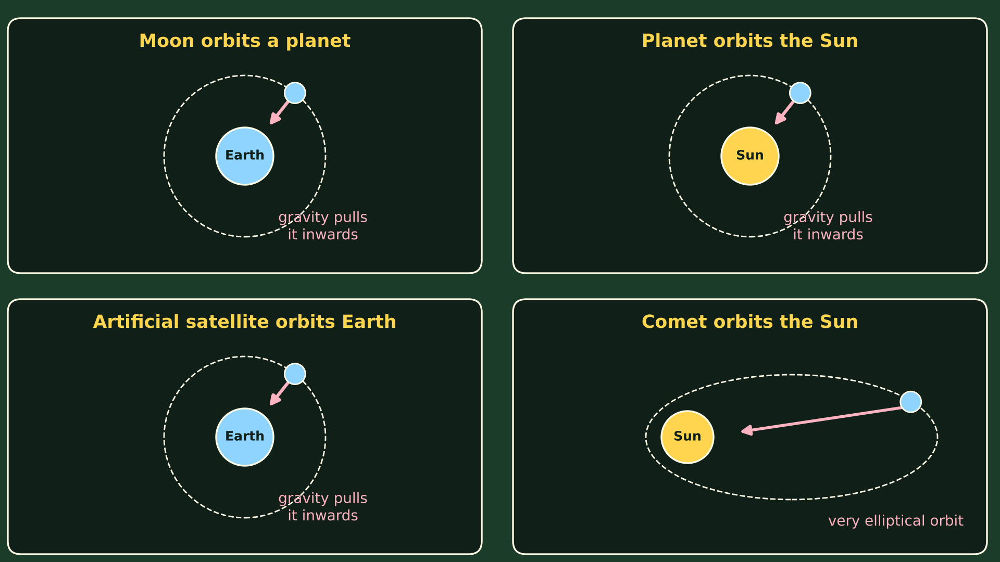
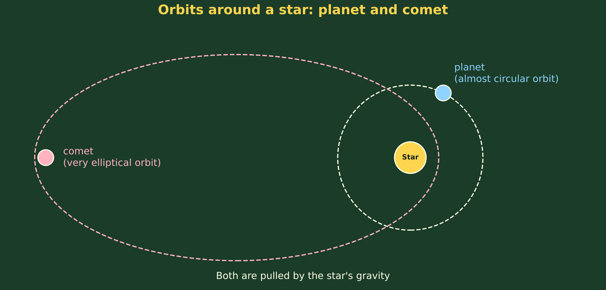
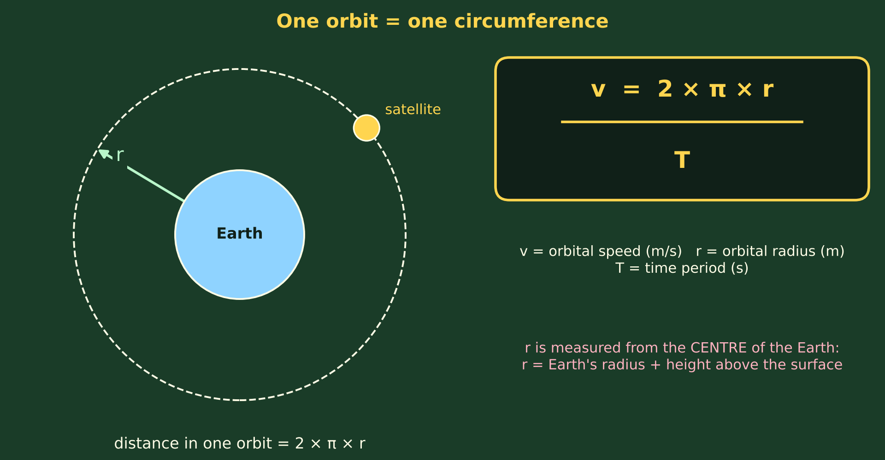
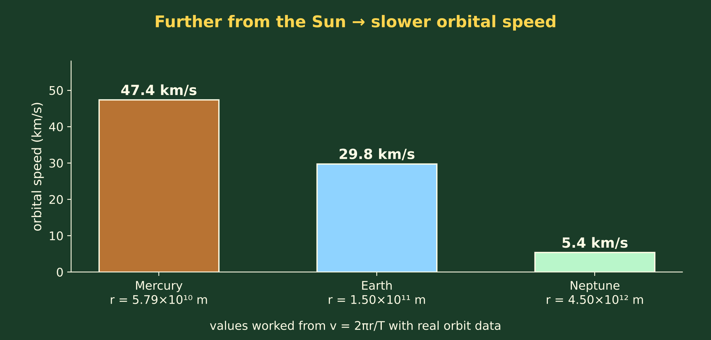

### Gravitational field strength (9.3)

Every mass has a **gravitational field** around it. The **gravitational field strength, g,** is the force on each kilogram placed in the field, in **N/kg**. It depends on the **mass of the planet or moon** and on **how far you are from its centre**. So g is **different on each planet and on the Moon**. The weight of an object is **W = m × g**: its mass stays the same, but its weight changes with g.

*Figure 2: gravitational field strength on the Moon and planets (N/kg, Student Book values)*

Method

Weight W (N) = mass m (kg) × g (N/kg).Example: a 50 kg student on Mars (g = 4 N/kg): W = 50 × 4 = <strong>200 N</strong>; on Earth (g = 10 N/kg) the weight is 500 N.

### Gravity and orbits (9.4)

Gravity is a **force of attraction between masses**. A small body moving past a large one is pulled **inwards**. It keeps moving forwards as it falls round the large body, so it follows a curved path — an **orbit**. Gravity causes: **moons to orbit planets**, **planets to orbit the Sun**, **artificial satellites to orbit the Earth**, and **comets to orbit the Sun**. Nothing else is needed to keep an orbit going.

*Figure 3: gravity pulls a body inwards, so it follows an orbit*

### Differences between orbits (9.5)

| **Body** | **Orbits** | **Shape of orbit** | **Notes** |
| --- | --- | --- | --- |
| Planet | the Sun | nearly circular | constant speed (nearly) |
| Moon | a planet | nearly circular | like planets, but around a planet |
| Comet | the Sun | long, thin ellipse | fast near the Sun, slow when far away |

*Figure 4: circular orbits for planets and moons; a long ellipse for a comet*

The **closer** a body is to the star or planet it orbits, the **stronger** the pull of gravity and the **faster** it moves; the **time period** (time for one orbit) is shorter.

### Orbital speed (9.6)

In one orbit a body travels the **circumference** of its path, 2πr, in one **time period T**. So **orbital speed v = 2πr ÷ T**, with v in m/s, r in m and T in s.

*Figure 5: one orbit = one circumference, 2πr, in one time period*

| **Level** | **Question** | **Full working (write it all on the board)** | **Answer** |
| --- | --- | --- | --- |
| Easy | A satellite orbits at r = 7.0 × 10⁶ m with T = 5900 s. Find v. | v = 2πr ÷ T = 2π × 7.0 × 10⁶ ÷ 5900 | 7.5 × 10³ m/s |

*Figure 6: speed and time period depend on the orbital radius*

Key facts

g is in N/kg; W = m × g.Gravity is the force that causes every orbit (moons, planets, satellites, comets).Planets and moons: nearly circular orbits. Comets: long, thin ellipses.v = 2πr ÷ T. Convert km to m first; give T in standard form.

Common Mistakes

Saying mass changes on another planet. Mass is the same; weight changes.Forgetting to convert km/s to m/s and km to m before using v = 2πr ÷ T.Writing ‘centrifugal force’ or ‘a force keeping it up’. The only force needed is gravity pulling inwards.Using the diameter instead of the radius in 2πr.

