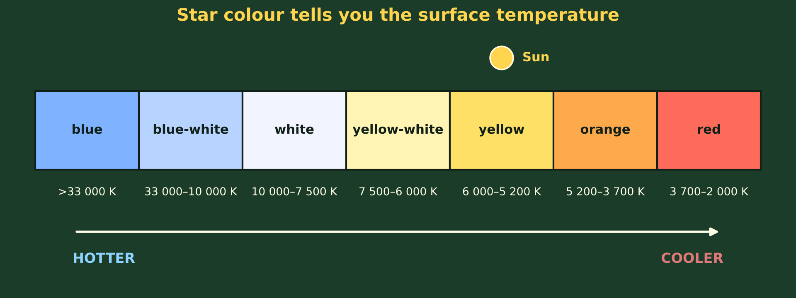
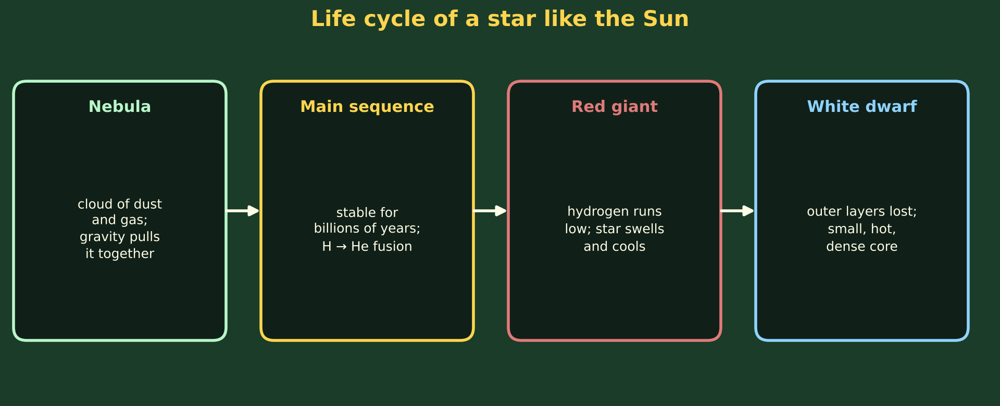
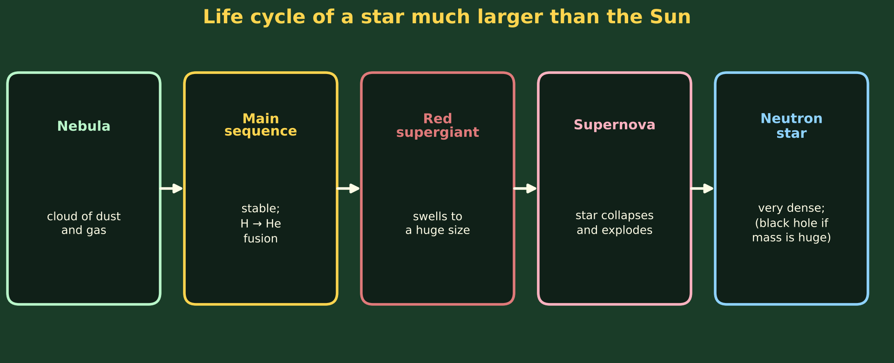

### Star colour and temperature (9.7, 9.8)

Stars are classified by their **colour**. A star’s colour depends on its **surface temperature**: **blue** stars are the **hottest**, then **white**, **yellow** (like the Sun), **orange**, and **red** stars are the **coolest**.

*Figure 7: star colour and surface temperature*

### A star like the Sun (9.9)

**Nebula** — a cloud of dust and gas pulled together by **gravity** until fusion starts. **Main sequence star** — stable for billions of years: **gravity inwards is balanced by the outward push from fusion**. **Red giant** — hydrogen in the core runs low; the star swells and its surface cools, so it glows red. **White dwarf** — the outer layers drift away leaving a small, hot, dense core that slowly cools.

*Figure 8: life cycle of a star like the Sun*

### A star larger than the Sun (9.10)

A star with **much more mass** than the Sun swells into a **red supergiant**, then **explodes as a supernova**, leaving a very dense **neutron star** (the Student Book adds a **black hole** for the most massive stars). The supernova throws dust and gas into space, giving material for new nebulae.

*Figure 9: life cycle of a star much larger than the Sun*

Key facts

Blue = hottest; red = coolest.Sun-like: nebula → main sequence → red giant → white dwarf.Larger: nebula → main sequence → red supergiant → supernova → neutron star (or black hole).Main sequence is stable because gravity inwards = outward push of fusion.

Common Mistakes

Saying red stars are the hottest.Saying the Sun will explode as a supernova — it will become a red giant, then a white dwarf.Calling fusion ‘burning’ or mixing it up with fission.

