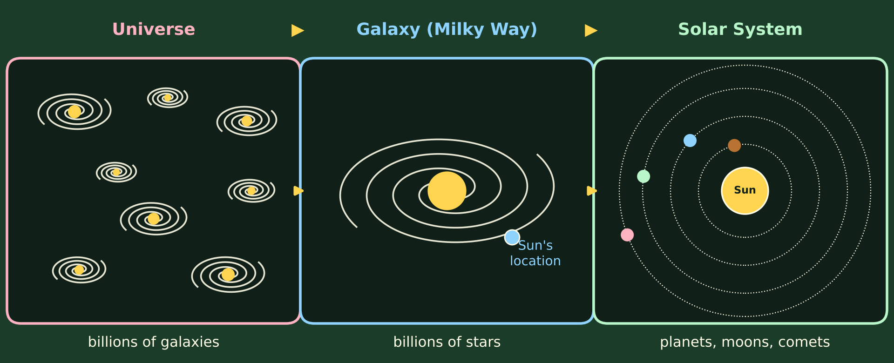

### Units (9.1)

| **Quantity** | **Unit** | **Symbol** |
| --- | --- | --- |
| mass | kilogram | kg |
| distance, radius | metre | m |
| speed | metre per second | m/s |
| acceleration | metre per second squared | m/s² |
| force, weight | newton | N |
| time, time period | second | s |
| gravitational field strength | newton per kilogram | N/kg |

Astronomical distances are huge, so numbers are written in **standard form**, for example 5.79 × 10¹⁰ m. Orbital speeds in km/s must be changed to m/s (× 1000) and distances in km to m (× 1000) before using v = 2πr ÷ T.

### The universe, galaxies and the Milky Way (9.2)

A **star** is a huge ball of hot gas that gives out its own light. A **galaxy** is a large collection of **billions of stars** held together by gravity. The **universe** is a large collection of **billions of galaxies**. Our **Solar System** (the Sun and the bodies that orbit it) is in the **Milky Way** galaxy.

*Figure 1: the scale of the universe — Solar System, galaxy, universe*

Key facts

Galaxy = billions of stars. Universe = billions of galaxies.The Solar System is in the Milky Way.

Common Mistakes

Writing that the Solar System is the same as the galaxy. The Solar System is a tiny part of the Milky Way.Putting the units in the wrong order: kg and N/kg are different — g is N/kg, mass is kg.

