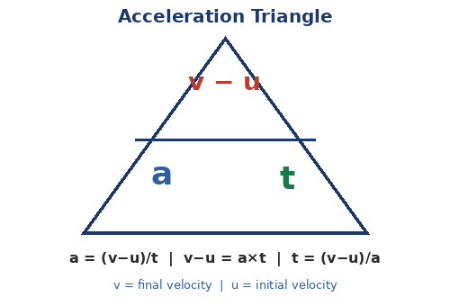
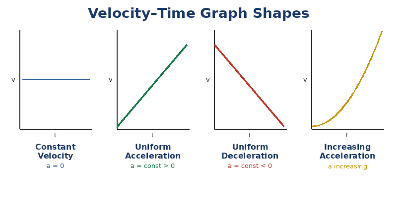
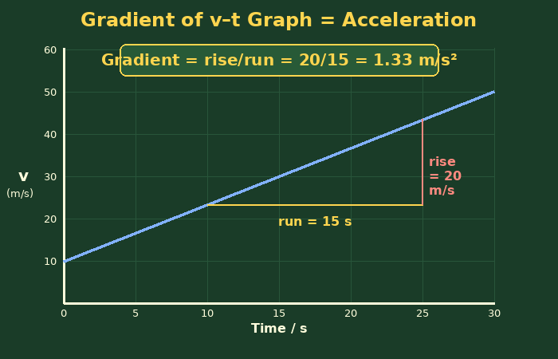
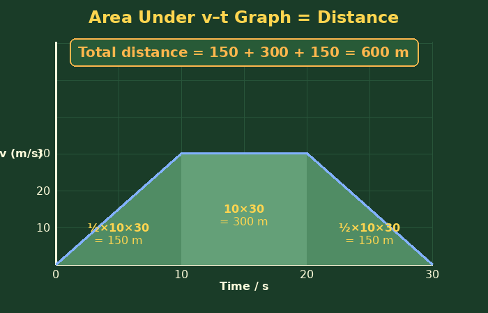
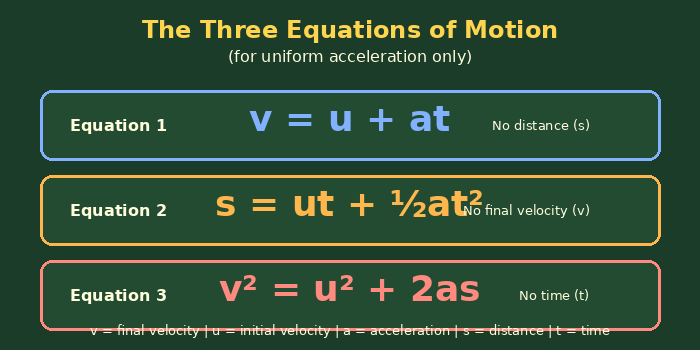
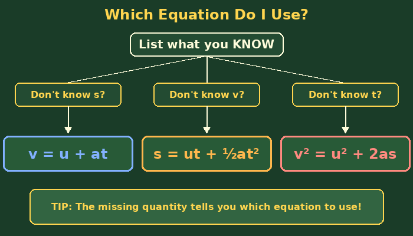

Key definition

<strong>Acceleration</strong> — The rate of change of velocity. How quickly speed changes. Formula: a = (v−u)/t. SI unit: m/s². Deceleration = negative acceleration.

Formula

<strong>a = (v − u) / t</strong>

a = acceleration (m/s²) | v = final velocity (m/s) | u = initial velocity (m/s) | t = time (s)

Key definition

<strong>Velocity</strong> — Speed in a stated direction. It is a vector quantity. A car going around a bend at constant speed has CHANGING velocity because its direction changes.

### Velocity–Time Graphs

### d–t Graph vs v–t Graph — Know the Difference!

| **Feature** | **d–t Graph** | **v–t Graph** |
| --- | --- | --- |
| **Gradient gives...** | SPEED | **ACCELERATION** |
| **Horizontal line...** | Stationary (v=0) | **Constant velocity (a=0)** |
| **Straight line up...** | Constant speed | **Uniform acceleration** |
| **Area under graph...** | (not used) | **DISTANCE TRAVELLED** |

### Gradient & Area of v–t Graphs

WORKED EXAMPLE 3

<strong>Q: A car accelerates from rest to 25 m/s in 5 s. Find: (a) acceleration (b) distance.</strong>

(a) a = (25−0)/5 = 5 m/s²

(b) Area = triangle = ½ × 5 × 25 = 62.5 m

<strong>✅ a = 5 m/s², distance = 62.5 m</strong>

### The Equations of Motion (1.10)

WORKED EXAMPLE 4

<strong>Q: A ball dropped from rest hits the ground at 20 m/s. g = 10 m/s². Find the height.</strong>

u=0, v=20, a=10, s=?

v²=u²+2as → 400=0+20s → s=20 m

<strong>✅ Height = 20 m</strong>

