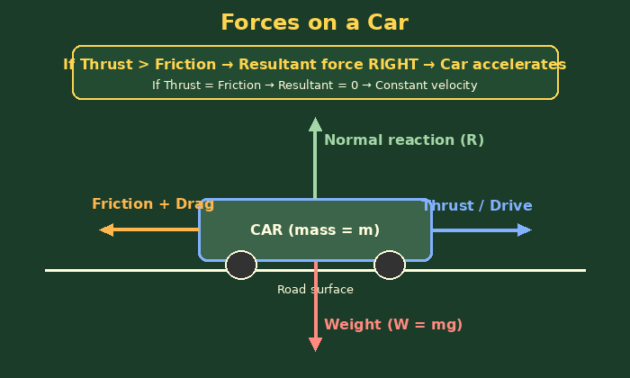
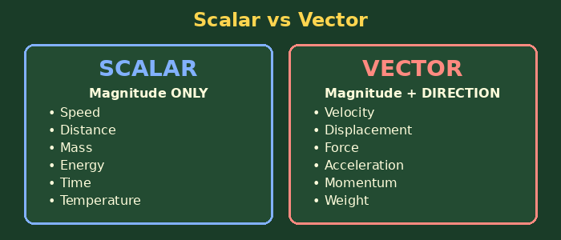
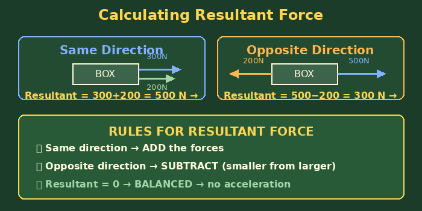

Key definition

<strong>Force</strong> — A push or pull that can change an object's speed, direction, or shape. Measured in newtons (N). Force is a VECTOR.

Effects of forces: (1) Change speed — accelerate or decelerate. (2) Change direction — e.g. turning a corner. (3) Change shape — stretch, compress, or bend.

### Resultant Force (1.15)

Key definition

<strong>Resultant Force</strong> — The single force that replaces all forces acting on an object. Same direction → ADD. Opposite → SUBTRACT. Resultant = 0 → balanced → no acceleration.

Key definition

<strong>Friction</strong> — A force that OPPOSES motion. Always acts opposite to the direction of movement. Without friction you could not walk, drive, or hold objects.

