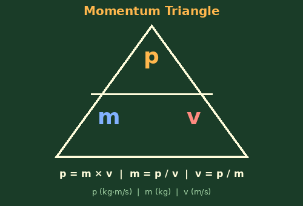
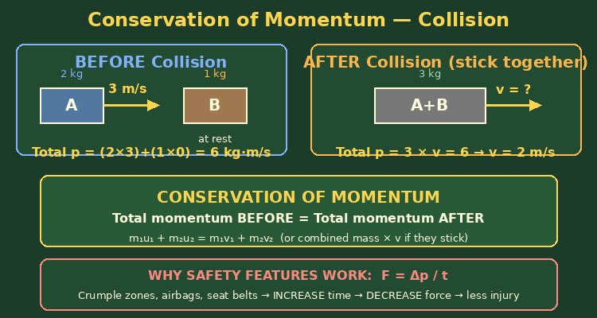
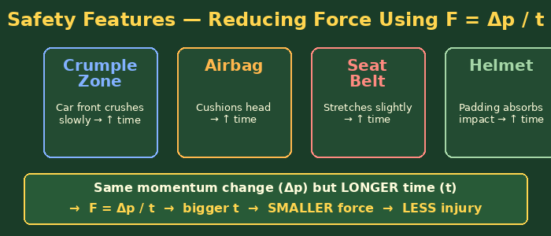
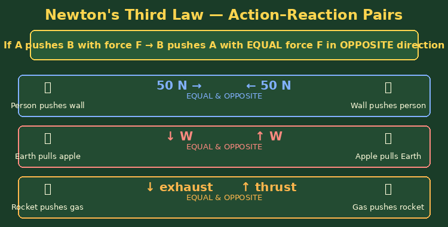

Formula

<strong>p = m × v     (Momentum)</strong>

p = momentum (kg·m/s) | m = mass (kg) | v = velocity (m/s). Momentum is a VECTOR.

Key definition

<strong>Conservation of Momentum</strong> — In a closed system, total momentum before a collision = total momentum after. m₁u₁ + m₂u₂ = m₁v₁ + m₂v₂

Formula

<strong>F = (mv − mu) / t</strong>

Force = change in momentum ÷ time. Safety features (crumple zones, airbags) increase time → reduce force.

### Newton's Third Law (1.29P)

Key definition

<strong>Newton's Third Law</strong> — When A exerts a force on B, B exerts an EQUAL and OPPOSITE force on A. Forces act on DIFFERENT objects, same type, same magnitude, opposite direction.

NOT THE SAME AS BALANCED FORCES!
<ul><li>Balanced forces act on the SAME object (e.g. weight and normal reaction on a book).</li><li>Newton's 3rd law pairs act on DIFFERENT objects (e.g. Earth pulls apple DOWN, apple pulls Earth UP).</li></ul>

