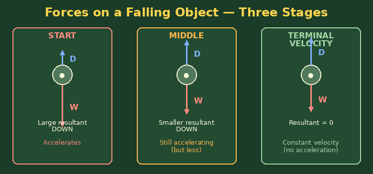
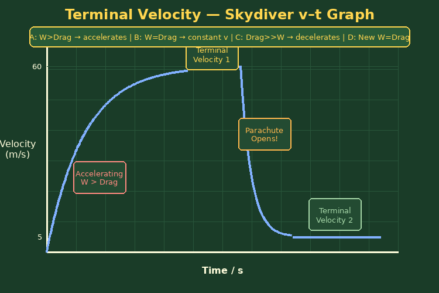

Key definition

<strong>Terminal Velocity</strong> — The constant maximum velocity reached when drag force equals weight, so resultant force = 0 and acceleration = 0.

**In a vacuum: no air resistance → all objects fall at the same rate (g = 10 m/s²) regardless of mass.**
