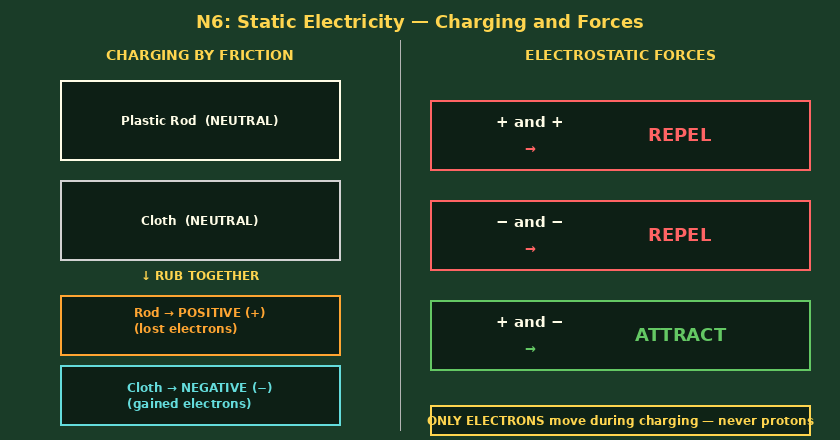
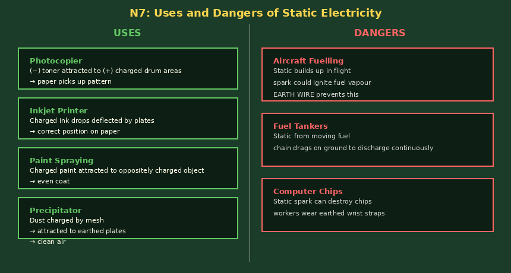

### Conductors and Insulators (Spec 2.22P)

- Conductors: Materials through which charge flows easily. Examples: copper, aluminium, iron, silver, graphite. Free electrons can move between atoms.
- Insulators: Materials that resist charge flow. Examples: plastic, rubber, glass, wood, ceramic. All electrons held tightly in atoms.

Only insulators can hold a static charge — in conductors, charge immediately flows away to earth.

### Charging by Friction (Spec 2.23P, 2.24P)

Fig N6: Charging by friction (left) and the three force scenarios between charges (right).

When two DIFFERENT insulating materials are rubbed together, electrons are transferred from one to the other.

The object that LOSES electrons becomes POSITIVELY charged (fewer electrons than protons).

The object that GAINS electrons becomes NEGATIVELY charged (more electrons than protons).

IMPORTANT: Only ELECTRONS transfer — protons NEVER move. Rubbing separates charge; it does NOT create it.

Total charge of both objects together = 0 (charge is conserved).

### Forces Between Charges (Spec 2.25P, 2.26P)

LIKE charges (both + or both −) REPEL each other.

UNLIKE (opposite) charges (+ and −) ATTRACT each other.

These are non-contact electrostatic forces — the charged objects do not need to touch.

Real-life example: A charged balloon (−) repels electrons from a wall surface, making it slightly (+), so the balloon sticks to the wall (unlike charges attract).

### Uses of Static Electricity (Spec 2.28P)

Fig N7: Uses (left) and dangers (right) of static electricity.

- Photocopier: Drum charged (+) all over. Light removes charge from white areas. Dark areas keep (+) charge. Negatively charged toner attracted to (+) areas. Paper pressed against drum picks up toner pattern. Heated to fix image permanently.
- Inkjet Printer: Ink drops are given a charge. Charged drops are deflected by electrostatic plates to the correct position on the paper. Plates change charge hundreds of times per second to form text and images.
- Electrostatic Paint Spraying: Paint drops given a charge; all same → they repel and spread out. Object has opposite charge → paint attracted to ALL surfaces including corners. Less paint wasted.
- Electrostatic Precipitator: Dust particles gain (−) charge from a mesh. Attracted to earthed (+) metal plates. Dust sticks and falls off. Clean air leaves chimney. Used in power stations and factories.

### Dangers of Static Electricity (Spec 2.27P)

- Aircraft Fuelling: Static builds up during flight from friction with air. When refuelling, a spark could ignite fuel vapour → explosion. Prevention: connect an earth wire from aircraft to tanker BEFORE attaching the fuel pipe.
- Fuel Tankers (Road): Static builds up as fuel moves. A metal chain trailing on the road continuously discharges the tanker to earth.
- Computer Chips: Very small static sparks can destroy sensitive circuits. Prevention: workers wear earthed wrist straps.

| **❌ COMMON MISCONCEPTION** | **✅ THE TRUTH** |
| --- | --- |
| 'Only positive charges can be transferred by friction' | No — it is always ELECTRONS (negative charges) that transfer. The object losing electrons becomes positive. |
| 'A charged object will only attract another charged object' | A charged object can ALSO attract uncharged objects by INDUCING an opposite charge on their surface. |
| 'The earth wire creates a spark hazard' | The LACK of an earth wire creates the hazard. An earth wire safely conducts charge to earth, preventing sparks. |
