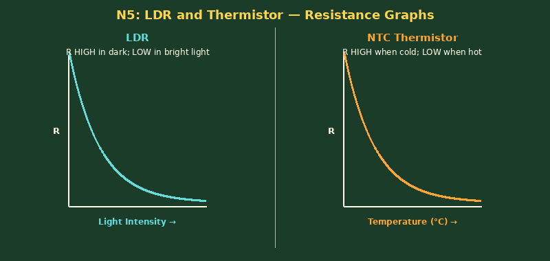

### LDR and Thermistor (Spec 2.11)

Fig N5: LDR (left) — resistance falls as light intensity increases. Thermistor (right) — resistance falls as temperature increases (NTC type).

- LDR (Light-Dependent Resistor): High R in dark; Low R in bright light. Uses: automatic street lighting, burglar alarms, camera exposure meters.
- NTC Thermistor: High R when cold; Low R when hot. Uses: fire alarms, thermostats, digital thermometers. NTC = Negative Temperature Coefficient.
- Lamp / LED (Spec 2.12): Used as indicators — glow when current is present. LEDs need far less energy than filament lamps.

### Sensor Circuits — Voltage Divider

An LDR or thermistor can be placed in series with a fixed resistor and a battery. A voltmeter across the fixed resistor shows Vout.

**DARK  (LDR circuit):**  LDR R HIGH → more V across LDR → Vout LOW → triggers switch to turn lamp ON

**LIGHT  (LDR circuit):**  LDR R LOW  → more V across fixed R → Vout HIGH → lamp OFF

**COLD  (Thermistor circuit):**  Thermistor R HIGH → Vout LOW → alarm OFF

**HOT  (Thermistor circuit):**  Thermistor R LOW → Vout HIGH → alarm TRIGGERS

### Current at a Junction (Spec 2.17)

In a parallel circuit, the total current flowing INTO a junction equals the total flowing OUT.

**ΣI\_in  =  ΣI\_out**    e.g.  0.6A  =  0.4A + 0.2A

This is because charge is conserved — it cannot be created or destroyed at a junction.

Spec 2.18: The VOLTAGE across components in PARALLEL is the SAME — each branch gets the full supply voltage.
