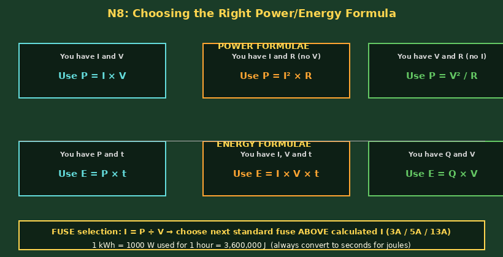

### Electrical Power (Spec 2.4)

Fig N8: Choosing the correct power/energy formula based on the information given.

| **Formula** | **When to use it** | **Example** |
| --- | --- | --- |
| **P = I × V** | Have I and V | I=2A, V=12V → P=24W |
| **P = I² × R** | Have I and R, no V | I=3A, R=10Ω → P=90W |
| **P = V² / R** | Have V and R, no I | V=230V, R=52.9Ω → P=1000W |

### Fuse Selection (Spec 2.4)

Step 1: Calculate normal operating current:  I = P ÷ V

Step 2: Choose the NEXT fuse rating ABOVE the calculated current from: 3A, 5A, 13A

Step 3: If the current is e.g. 10A → the 13A fuse is the correct choice (5A would immediately blow).

Real-life example: 2300W electric shower at 230V → I = 10A → use 13A fuse.

### Energy and kWh (Spec 2.5)

- E = P × t: Energy in joules when P is in watts and t is in SECONDS
- E = I × V × t: Full form — same calculation
- kWh: Energy in kilowatt-hours: Power (kW) × Time (hours). Used on electricity bills.
- Conversion: 1 kWh = 3 600 000 J = 3.6 MJ

Key fact

A 1kW appliance used for 1 hour uses 1 kWh = 3.6 MJ of energy

⭐  Watts is the unit of POWER (rate). Joules (or kWh) is the unit of ENERGY (total amount)

⭐  To convert kWh to J: multiply by 3,600,000

