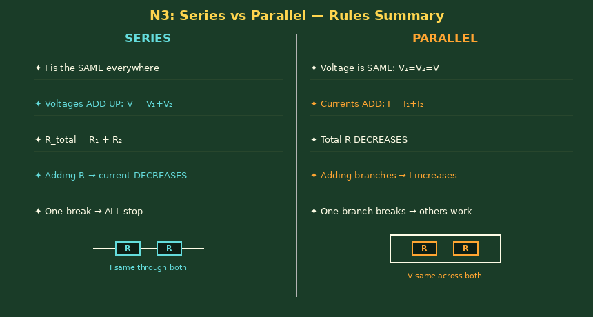
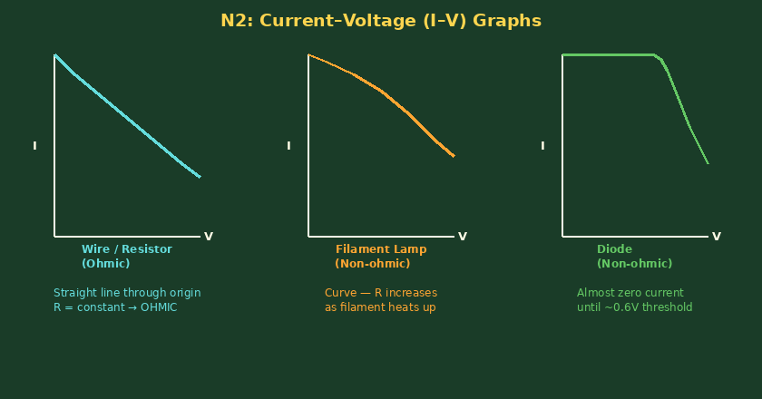

### Series and Parallel Circuits — When to Use Each (Spec 2.7–2.8)

Fig N3: Series circuit rules (left) vs Parallel circuit rules (right).

Domestic lighting is wired in PARALLEL because: (1) each lamp gets the full 230V supply, staying at full brightness; (2) if one lamp fails, the others keep working; (3) each lamp has its own switch.

Christmas/decorative lights are wired in SERIES so each bulb only needs a fraction of the total voltage — but if one fails, all go out.

### Ohm's Law (Spec 2.13)

**V = I × R**    →    voltage (V) = current (A) × resistance (Ω)

Ohm's Law: For a metallic conductor at constant temperature, the current is directly proportional to the voltage applied.

Rearrangements:  I = V ÷ R   (to find current)    \|    R = V ÷ I   (to find resistance)

Series total resistance: R\_total = R₁ + R₂  (for two resistors in series)

### I–V Graphs (Spec 2.9)

Fig N2: I–V graphs for (left) ohmic resistor — straight line through origin; (middle) filament lamp — curve, R increases as it heats; (right) diode — no current until ~0.6V threshold.

- Ohmic conductor (wire/resistor): Straight line through origin — current proportional to voltage. R is constant.
- Filament lamp: Curved line — as V increases, filament heats, R increases, slope decreases.
- Diode: Almost no current until threshold voltage (~0.6V). Then current rises sharply. In reverse — near zero current.

### Effect of Changing Resistance (Spec 2.10)

If resistance in a circuit INCREASES → current DECREASES (for a fixed voltage: I = V ÷ R).

If resistance DECREASES → current INCREASES. A variable resistor (rheostat) is used to control current in a circuit.

| **❌ COMMON MISCONCEPTION** | **✅ THE TRUTH** |
| --- | --- |
| 'A straight I–V graph means the component obeys Ohm's Law' | Technically true, but examiners want: 'current is directly proportional to voltage' — say BOTH the shape AND the explanation. |
| 'Diodes block all current in the reverse direction' | Diodes allow a very tiny leakage current in reverse — for IGCSE we say 'very high resistance / no significant current'. |
