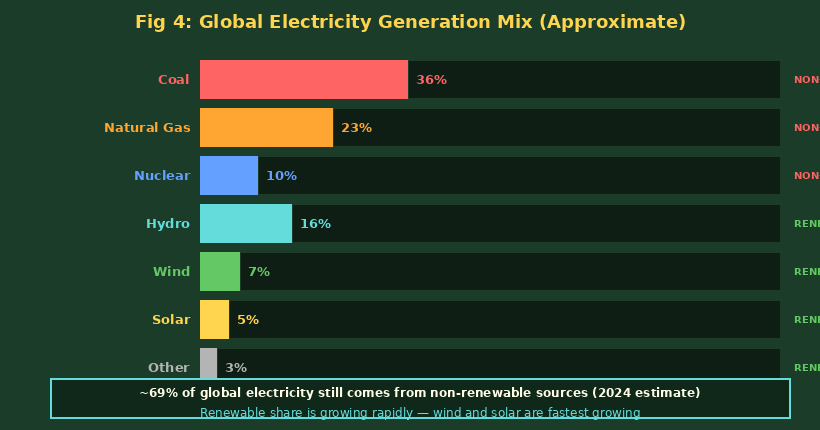
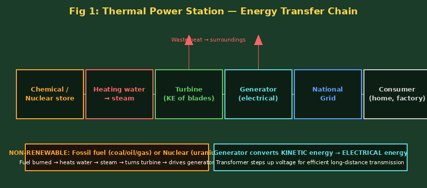
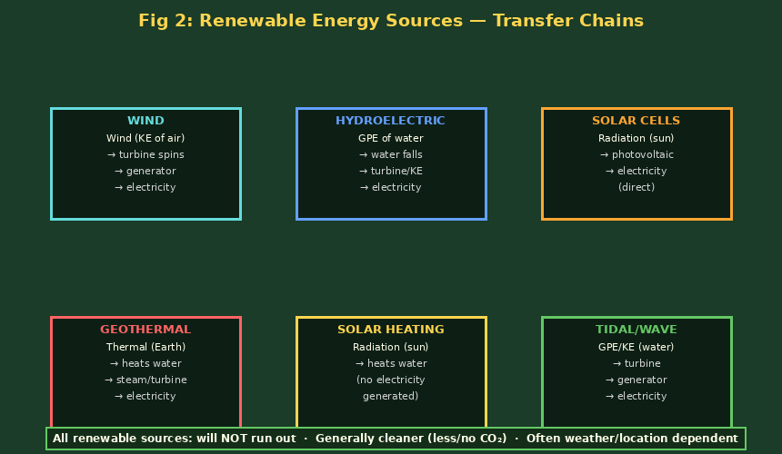
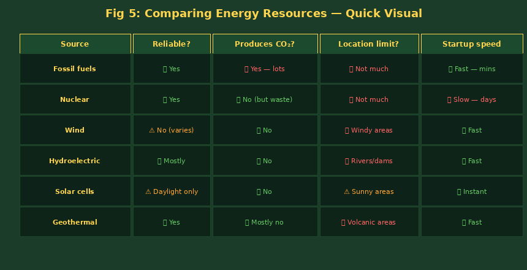
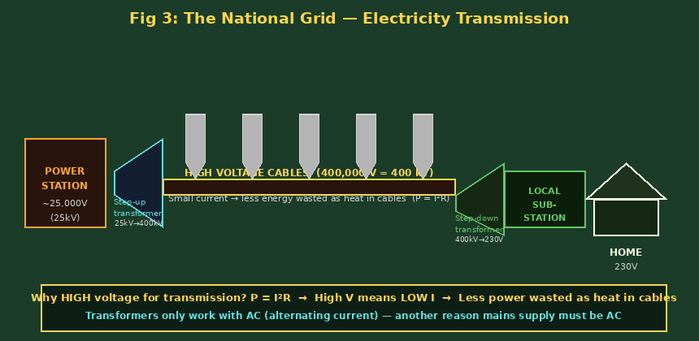

### Renewable vs Non-Renewable

📌 Spec 3.18P

| **Non-renewable** | **Renewable** |
| --- | --- |
| Cannot be replaced once used | Will not run out |
| Coal, oil, gas (fossil fuels) | Wind, solar, hydro, geothermal, tidal |
| Nuclear fuel (uranium) | (also nuclear fusion — not yet used at scale) |
| Most reliable — on demand | Often weather or location dependent |

Fig D1: Approximate global electricity mix. ~69% still non-renewable. Wind and solar are fastest growing.

### How Electricity is Generated — Thermal Power Stations

📌 Spec 3.18P

ALL thermal power stations (fossil fuel and nuclear) follow the same basic chain:

Fig D2: Thermal power station energy chain. Fuel heats water → steam → turbine → generator → electricity. The generator uses electromagnetic induction (covered in Topic 7).

- FOSSIL FUELS: Chemical store → burning → thermal → steam → turbine KE → generator → electrical
- NUCLEAR: Nuclear store → fission → thermal → steam → turbine KE → generator → electrical
- Key difference: fuel type and energy store. The turbine-generator step is identical in both.

### Renewable Energy Sources

📌 Spec 3.18P

Fig D3: Renewable energy transfer chains. All except solar heating panels generate electricity via a generator.

| **Source** | **Energy store** | **Transfer chain** | **Key exam points** |
| --- | --- | --- | --- |
| Wind | KE (air) | KE→turbine→KE→generator→elec | Intermittent — no wind = no power; noisy; visual impact |
| Hydroelectric | GPE (water) | GPE→fall→KE→turbine→generator→elec | Reliable; floods valleys; disrupts ecosystems |
| Solar cells | Radiation | Radiation→photovoltaic→electrical (DIRECT) | Only daylight; no turbine needed; silent |
| Solar heating | Radiation | Radiation→heats water (hot water only) | Does NOT generate electricity; good for water heating |
| Geothermal | Thermal (Earth) | Thermal→heats water→steam→turbine→elec | Reliable 24/7; only in volcanic regions (Iceland, NZ) |

### Advantages & Disadvantages

📌 Spec 3.19P

Fig D4: Quick comparison across key criteria. ✅=good ⚠=partial ❌=poor.

| **Source** | **Advantages** | **Disadvantages** |
| --- | --- | --- |
| Fossil fuels | Reliable; on-demand; large output; existing infrastructure | CO₂ → global warming; air pollution; will run out; mining damage |
| Nuclear | No CO₂ during operation; huge output; small fuel volume | Radioactive waste; expensive to build; slow startup; accident risk |
| Wind | No CO₂; free fuel; low running cost | Intermittent; noisy; visual impact; location dependent |
| Hydroelectric | No CO₂; reliable; fast response to demand | Floods valleys; disrupts ecosystems; needs large river |
| Solar cells | No CO₂; silent; minimal maintenance; good for remote areas | Only daylight; weather dependent; high setup cost |
| Geothermal | No CO₂; reliable 24/7; free energy from Earth | Only volcanic regions; high drilling costs |

| **❌  MISCONCEPTION** | **✅  TRUTH** |
| --- | --- |
| Nuclear power produces CO₂ | Nuclear stations do NOT produce CO₂ during operation. The concern is radioactive waste and accident risk — not greenhouse gas emissions. |
| Solar panels work at night | Solar CELLS require sunlight — they produce no electricity at night without battery storage. Solar heating panels also only work in daylight. |
| Nuclear fuel is renewable because it keeps generating power | Uranium (nuclear fuel) is NON-RENEWABLE — it will eventually run out and cannot be naturally replenished on human timescales. |

### The National Grid

📌 Spec 3.19P

Formula

<strong>Why high voltage?  P = I²R  →  High V means low I  →  Much less power wasted in cables</strong>

Fig D5: The National Grid. Power station (25kV) → step-up transformer → 400kV cables → step-down transformer → home (230V). High voltage minimises current and cable heating losses.

| **Component** | **Voltage** | **Role** |
| --- | --- | --- |
| Power station | ~25,000V (25kV) | Generates electricity |
| Step-up transformer | 25kV → 400kV | Increases voltage for transmission |
| High-voltage cables | 400kV | Carries current across country at low I |
| Step-down transformer | 400kV → 230V | Reduces to safe level for homes |
| Consumer (home) | 230V | Uses electricity safely |

- HIGH VOLTAGE → LOW CURRENT → LESS HEAT WASTED in cables (P = I²R)
- Transformers ONLY work with AC — a changing magnetic field is required for induction
- This is why UK mains must be AC (230V, 50Hz), not DC

| **❌  MISCONCEPTION** | **✅  TRUTH** |
| --- | --- |
| High voltage is dangerous so we should transmit at low voltage | High voltage TRANSMISSION reduces current and energy loss. The voltage is stepped DOWN to safe 230V before reaching homes. The high voltage is only in pylons, not in homes. |
| Transformers work with DC | Transformers require a CHANGING magnetic field — only possible with AC. DC produces a constant field → no transformer action → would not work. |

Key fact

National Grid sequence: power station → step-up → cables (400kV) → step-down → homes (230V)

⭐  High voltage = low current = low I²R losses in cables = efficient transmission

⭐  Transformers only work with AC — this is why mains must be alternating current

