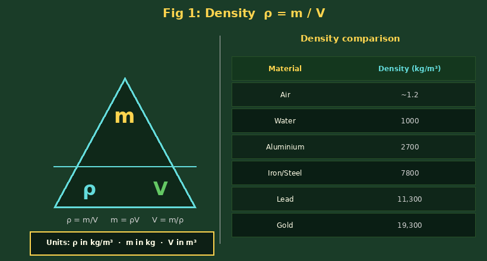
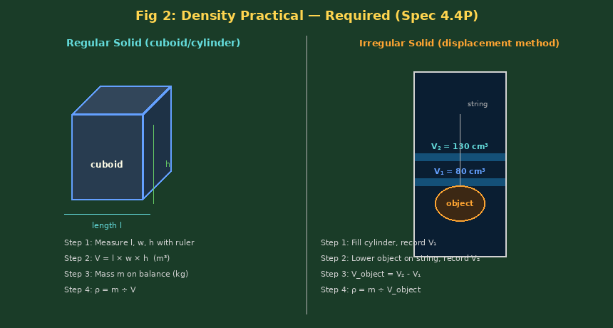
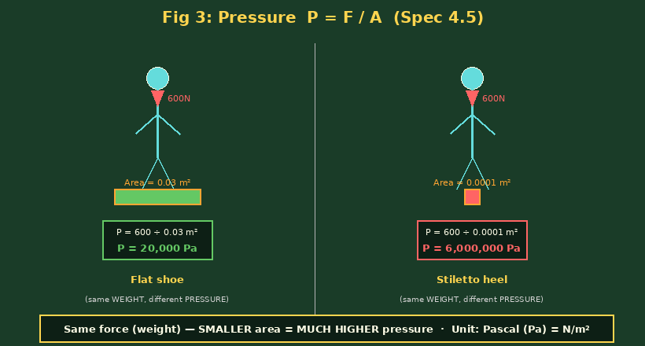
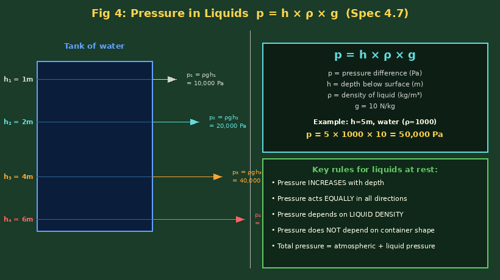

### Density ρ = m/V

Formula

<strong>ρ = m / V          ρ (kg/m³)  ·  m (kg)  ·  V (m³)</strong>

Density is the mass per unit volume of a substance. It tells us how much mass is packed into each cubic metre.

Fig A1: Density formula triangle and comparison table. Always convert g→kg (÷1000) and cm³→m³ (÷1,000,000) before calculating.

Unit conversions (essential):

- 1 g = 0.001 kg  ·  1 kg = 1000 g
- 1 cm³ = 0.000001 m³  ·  1 m³ = 1,000,000 cm³
- 1 cm³ = 1 mL  ·  1 litre = 1000 cm³

### Required Practical — Measuring Density (Spec 4.4P)

Fig A2: Regular solid (ruler → V=l×w×h) and irregular solid (displacement → V=V₂−V₁). For a liquid: mass by difference ÷ volume in cylinder.

Regular solid: measure dimensions with a ruler, V = l×w×h. Irregular solid: displacement method, V = V₂−V₁. Liquid: mass of liquid ÷ volume in measuring cylinder.

### Pressure P = F/A

Formula

<strong>P = F / A          P (Pa = N/m²)  ·  F (N)  ·  A (m²)</strong>

Pressure is the force acting per unit area. The same force over a smaller area gives a higher pressure.

Fig A3: Same weight (600N) on flat shoe (0.03m²→20,000Pa) vs stiletto (0.0001m²→6,000,000Pa). Smaller area = much higher pressure.

- Increase pressure → decrease area (sharp knife, needle, stiletto)
- Decrease pressure → increase area (snowshoes, skis, camel feet, tractor tyres)
- 1 Pascal (Pa) = 1 N/m²

### Pressure in Liquids p = hρg

Formula

<strong>p = h × ρ × g          p (Pa)  ·  h = depth (m)  ·  ρ (kg/m³)  ·  g = 10 N/kg</strong>

Fig A4: Pressure increases with depth. At any point it acts equally in all directions and depends only on depth and density — NOT on container shape.

- Pressure increases with depth (more liquid above pushing down)
- Pressure acts equally in ALL directions at a point in a fluid
- Pressure depends on depth and density only — not container shape
- Total pressure = atmospheric pressure + hρg

| **❌  MISCONCEPTION** | **✅  TRUTH** |
| --- | --- |
| ρ = m×V (multiplying) | ρ = m÷V. Double the volume with same mass → density halves. |
| Pressure depends on container shape | p=hρg depends only on depth and density. Same depth = same pressure in any shaped container. |
| Denser objects are always heavier | Density is mass per unit VOLUME. A large foam block weighs more than a gold ring but is far less dense. |
