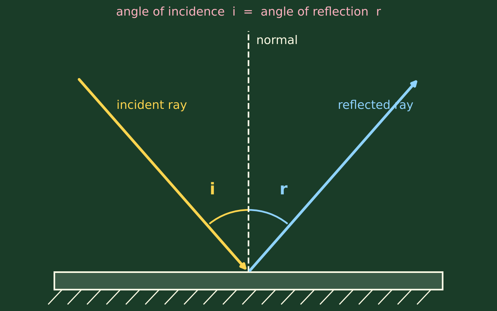
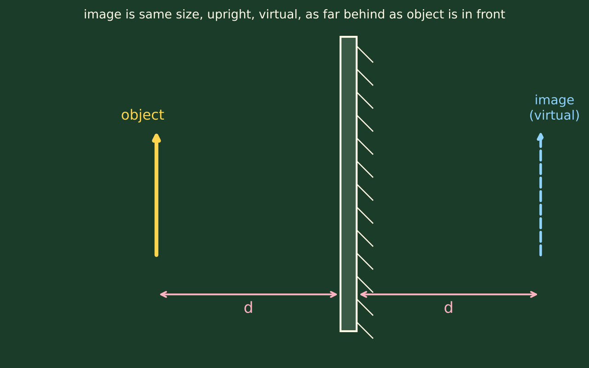

Light is a transverse wave that can be reflected and refracted. At a mirror it obeys the law of reflection.

Formula

<strong>Law of reflection: angle of incidence i = angle of reflection r.</strong> Both angles are measured from the normal (the line at 90° to the surface).

**The law of reflection**

Image in a plane mirror: same size as the object, upright, virtual, laterally inverted (left–right swapped), and as far behind the mirror as the object is in front.

**Image in a plane mirror**

Common misconception

Measuring angles from the mirror surface. Always measure from the <strong>normal</strong>.

