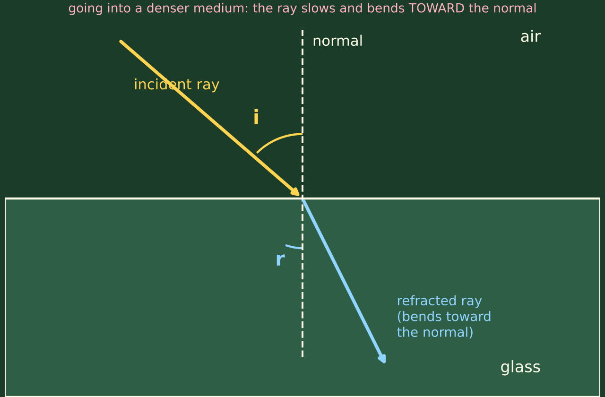

Refraction is the change in direction of light when it changes speed on passing from one material to another. Going into a denser medium (e.g. air → glass) the light slows and bends towards the normal; coming out it speeds up and bends away from the normal. A ray along the normal does not bend.

**Refraction of light into glass**

Formula

<strong>refractive index n = sin i ÷ sin r</strong>   (n has no unit; i and r measured from the normal)

**Required practical:** shine a ray into a glass block, mark the incident and emerging rays, measure i and r for several angles, then calculate n = sin i ÷ sin r and average — or plot sin i against sin r and take the gradient.

**Worked example.** i = 40°, r = 25°: n = sin 40 ÷ sin 25 = 0.643 ÷ 0.423 = 1.52.

Common misconception

Writing n = i ÷ r. You must take the <strong>sine</strong> of each angle first: n = sin i ÷ sin r.

