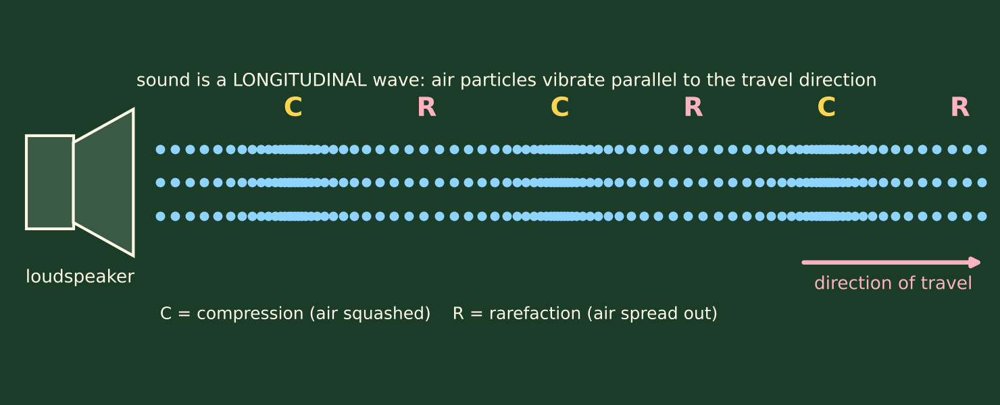
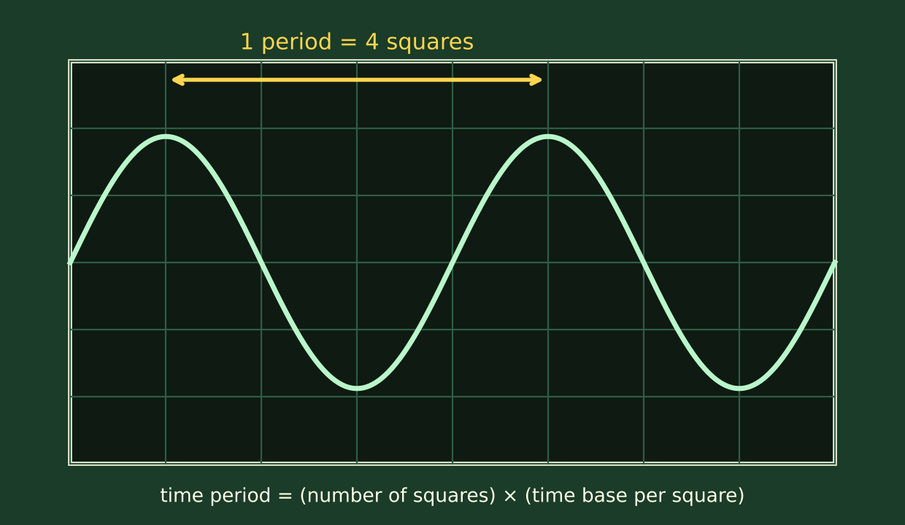
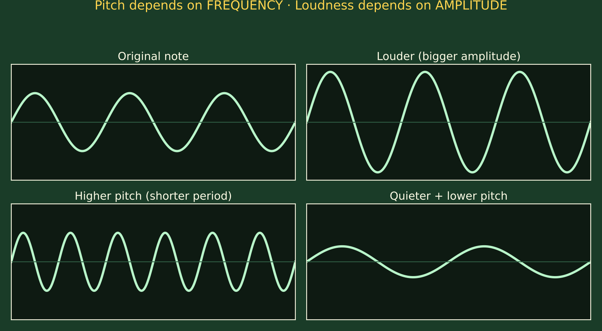

Sound is a longitudinal wave made of compressions and rarefactions. It needs a medium, so it cannot travel through a vacuum, and like all waves it can be reflected (an echo) and refracted. The human hearing range is 20 Hz to 20 000 Hz.

**Sound as a longitudinal wave**

### Measuring the speed of sound (5.25P)

Two microphones a measured distance d apart are connected to a fast timer. A sharp sound starts the timer at the first microphone and stops it at the second, giving time t. Then v = d ÷ t. (Echo method: clap in time with echoes from a wall a known distance away and time many claps.) The speed of sound in air is about 340 m/s.

### The oscilloscope (5.26P, 5.27P)

A microphone connected to an oscilloscope displays a sound wave on a grid. The time base sets the time per square. Read the time period as: number of squares for one wave × time per square, measuring across several waves to reduce error. Then f = 1 ÷ T.

**Reading the time period on an oscilloscope**

### Pitch and loudness (5.28P, 5.29P)

Pitch depends on frequency: a higher frequency gives a higher pitch (waves closer together on the screen). Loudness depends on amplitude: a bigger amplitude gives a louder sound (a taller trace).

**Pitch depends on frequency; loudness depends on amplitude**

Key facts

Sound is <strong>longitudinal</strong>, needs a <strong>medium</strong>, hearing range <strong>20–20 000 Hz</strong>, speed in air ≈ <strong>340 m/s</strong>.Pitch ← frequency.  Loudness ← amplitude.

