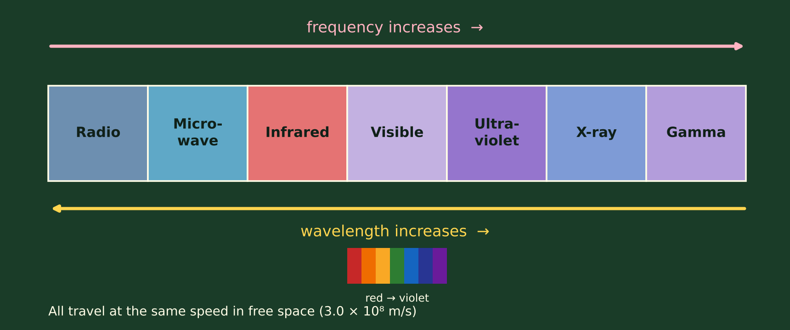

Visible light is one small part of a continuous family of transverse waves. All electromagnetic (EM) waves travel at the same speed in free space (a vacuum): 3.0 × 10⁸ m/s.

**The electromagnetic spectrum**

In order of increasing frequency (decreasing wavelength): **radio, microwave, infrared, visible, ultraviolet, X-ray, gamma.** The visible colours, from longest to shortest wavelength, are red, orange, yellow, green, blue, indigo, violet.

### Uses (5.12)

| **Region** | **Use** |
| --- | --- |
| Radio | Broadcasting and communications |
| Microwave | Cooking; satellite transmissions |
| Infrared | Heaters; night-vision; remote controls |
| Visible | Optical fibres; photography; seeing |
| Ultraviolet | Fluorescent lamps; security marking |
| X-ray | Imaging internal structures / bones |
| Gamma | Sterilising equipment; treating cancer |

### Dangers and protection (5.13)

| **Region** | **Danger** | **Protection** |
| --- | --- | --- |
| Microwave | Internal heating of body tissue | Metal mesh/case shields the user |
| Infrared | Skin burns | Distance; heat-resistant screens |
| Ultraviolet | Skin cancer; blindness | Sun-cream; sunglasses; cover skin |
| Gamma | Cancer; cell mutation | Lead/concrete shielding; limit time |

Key facts

The property that is the <strong>same</strong> for all EM waves in a vacuum is their <strong>speed</strong> (3.0 × 10⁸ m/s).Higher frequency → more energy → more dangerous (UV, X-ray, gamma).

Common misconception

‘All EM waves have the same frequency.’ No — the <strong>speed</strong> is the same; frequency and wavelength differ across the spectrum.

