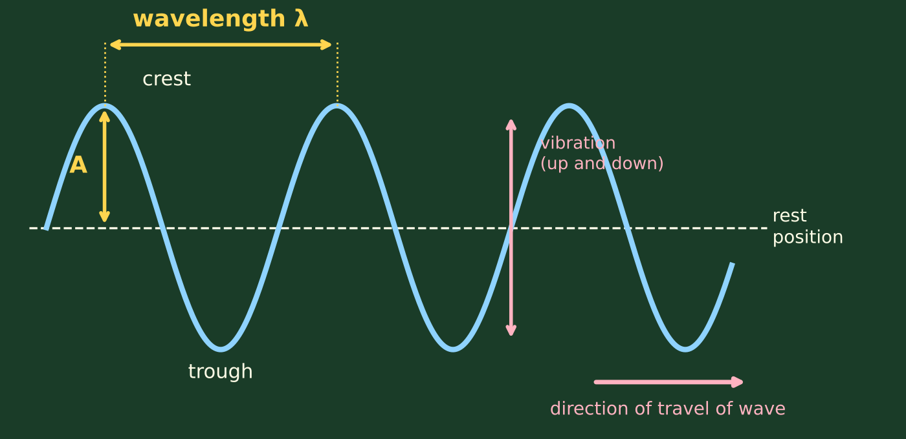
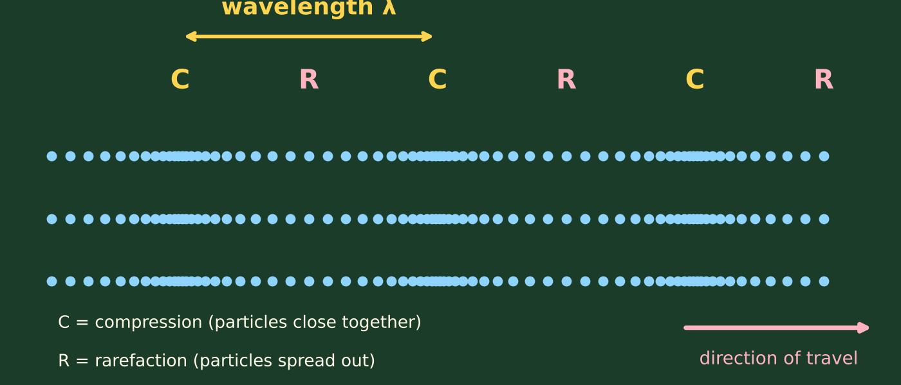

### Transverse and longitudinal waves (5.2)

A wave is a disturbance that transfers energy and information from one place to another without transferring matter. There are two types.

- **Transverse wave:** the vibrations are at 90° (right angles) to the direction of energy transfer. Examples: all electromagnetic waves (light, radio, X-rays), water ripples, a wave on a rope.
- **Longitudinal wave:** the vibrations are parallel to the direction of energy transfer. The wave is made of compressions (particles squashed together) and rarefactions (particles spread out). Examples: sound, a slinky pushed and pulled.

**A transverse wave**

**A longitudinal wave**

### Key terms and units (5.1, 5.3)

| **Term** | **Meaning** | **Unit** |
| --- | --- | --- |
| Amplitude (A) | Maximum displacement from the rest position | metre (m) |
| Wavelength (λ) | Distance from one point on a wave to the same point on the next wave (e.g. crest to crest) | metre (m) |
| Frequency (f) | Number of complete waves passing a point each second | hertz (Hz) |
| Period (T) | Time for one complete wave to pass a point | second (s) |
| Wavefront | A line joining points of a wave that are all at the same stage of the cycle | — |

Key facts

Waves transfer <strong>energy</strong> and <strong>information</strong>, never <strong>matter</strong>.Amplitude is measured from the <strong>rest position</strong> to a crest (or trough), not crest-to-trough.Units to know: Hz, m, s, m/s, and the degree (°) for angles.

Common misconception

‘The water travels across the pond.’ No — only energy moves; a floating cork just bobs up and down on the spot.

