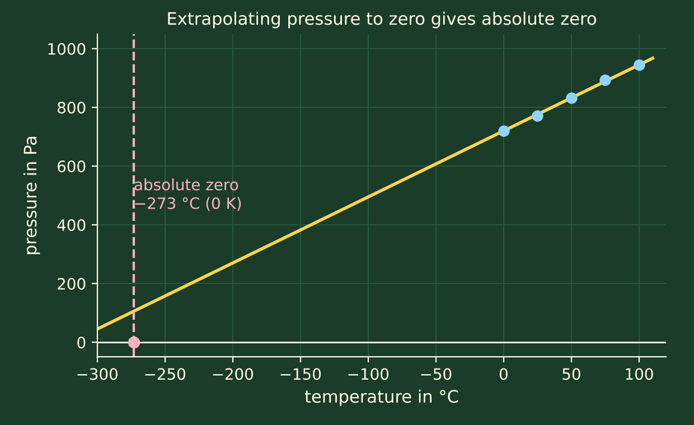
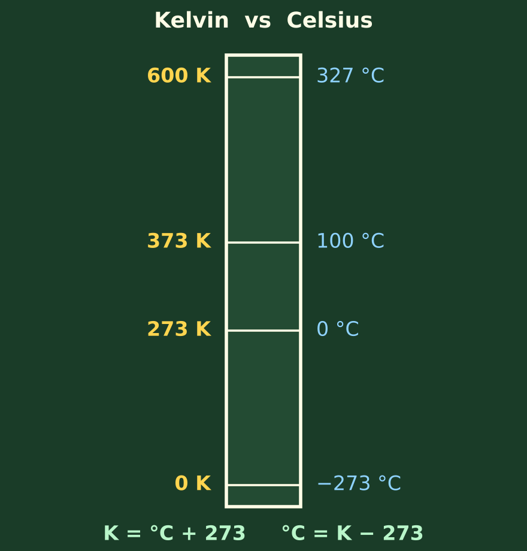

Cooling a gas slows its molecules, so they hit the walls less often and less hard and the pressure falls. A pressure–temperature graph is a straight line; extending it back, the pressure would reach zero at about −273 °C. This is absolute zero — the lowest possible temperature, where molecules have minimum (effectively zero) kinetic energy. Nothing can be colder.

**Extrapolating pressure to zero gives absolute zero**

Physicists measure from absolute zero using the Kelvin (K) scale. A change of 1 K equals a change of 1 °C; only the starting point differs.

**The Kelvin and Celsius scales**

Formula

<strong>K = °C + 273</strong>   and   <strong>°C = K − 273</strong>0 K = −273 °C · 273 K = 0 °C · 373 K = 100 °C

Common misconception

Writing absolute zero as +273 °C or 0 °C. It is −273 °C, i.e. 0 K.

