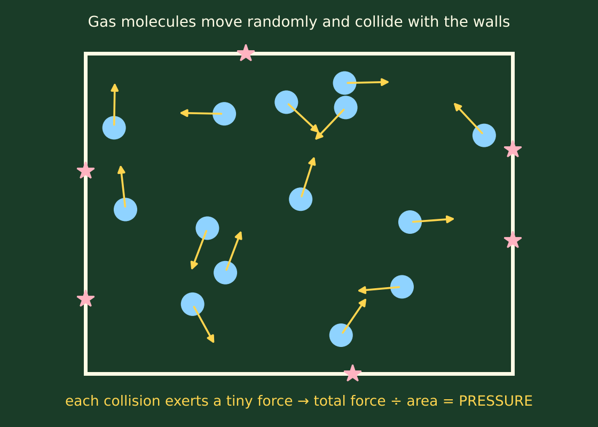

A gas is made of molecules in constant, random motion, moving in all directions at high speed. They continually collide with the walls of their container. Each collision exerts a tiny force on the wall; the many collisions together give a steady total force. Pressure is this force divided by the area of the wall.

**Gas molecules colliding with the walls create pressure**

Key facts

Gas pressure = molecules colliding with the walls (force ÷ area).More molecules, or faster molecules, → more collisions → more pressure.The motion is random, so the pressure acts equally in all directions.

Common misconception

‘The molecules push the walls.’ Be specific — pressure comes from molecules colliding with the walls.

