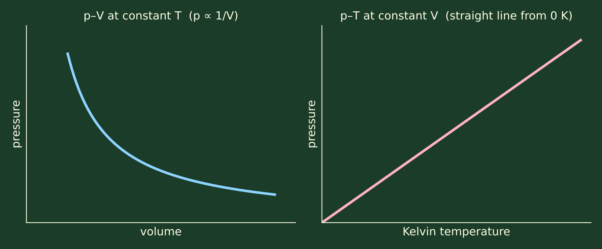

For a fixed amount of gas there are two qualitative relationships.

- **At constant temperature:** squeezing the gas into a smaller volume makes the molecules hit the walls more often, so the pressure rises. Pressure and volume are inversely related (p ∝ 1/V) — a curved graph.
- **At constant volume:** heating the gas makes the molecules move faster and hit the walls harder and more often, so the pressure rises with Kelvin temperature. The p–T graph is a straight line through 0 K.

**p–V at constant T (left) and p–T at constant V (right)**
