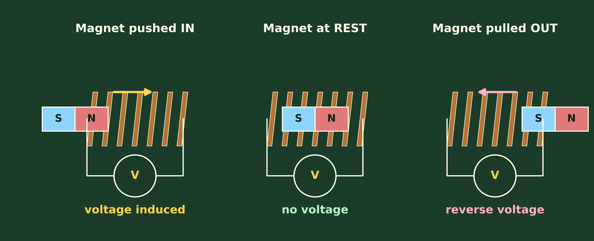
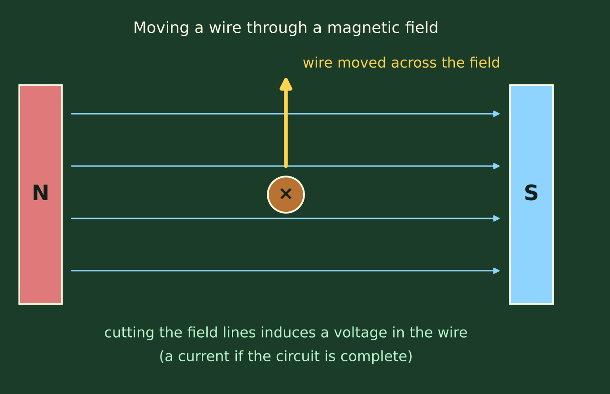
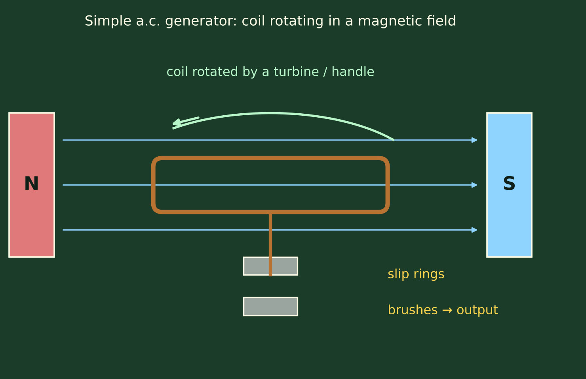
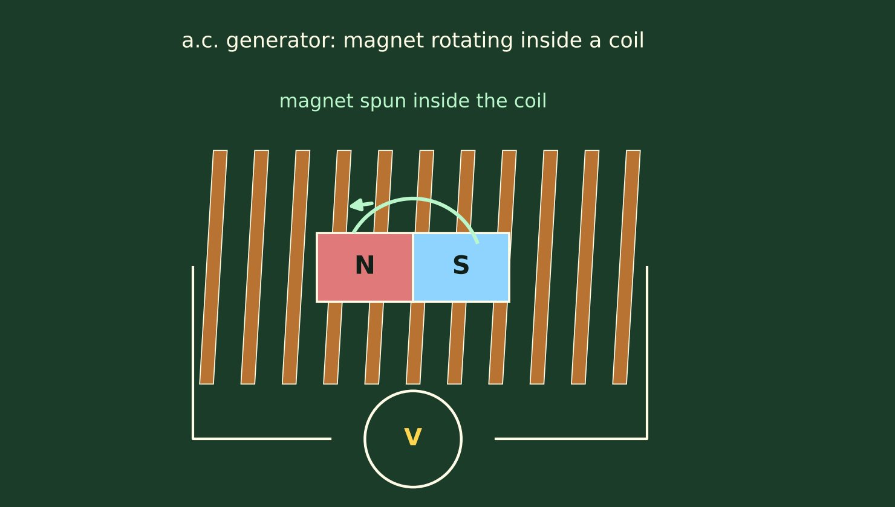
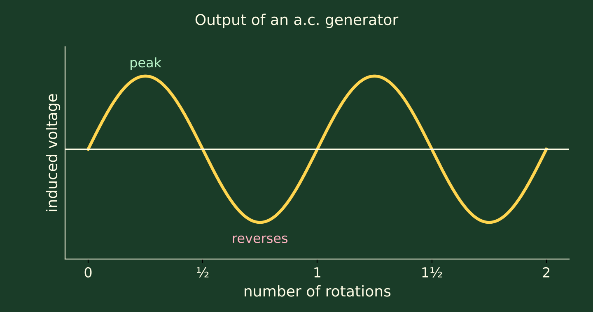

### Inducing a voltage (7.15)

A **voltage is induced** in a conductor or coil when it moves through a magnetic field, or when the magnetic field through it changes — the conductor cuts the field lines. This is **electromagnetic induction**. If the circuit is complete, a current flows. If there is no relative movement, there is no voltage. Pulling the magnet out reverses the voltage.

*Figure 18: voltage is induced only while the magnet moves*

*Figure 19: moving a wire through a field induces a voltage*

| **Change** | **Effect on the induced voltage** |
| --- | --- |
| Move faster | Increases |
| Stronger magnet | Increases |
| More turns on the coil | Increases |
| Reverse the movement | Voltage reverses |
| No movement | No voltage |

### Generators (7.16)

A generator turns movement into electrical energy by rotation: either a **coil rotates in a magnetic field** (power stations) or a **magnet rotates inside a coil** (bicycle dynamo). The output **reverses every half turn**, so it is alternating. **Slip rings and brushes** keep the rotating coil connected to the circuit. A larger voltage comes from faster rotation, stronger magnets or more turns.

*Figure 20: a generator with a rotating coil*

*Figure 21: a generator with a rotating magnet*

*Figure 22: the alternating output*

Key facts

Voltage is induced when a conductor cuts field lines (relative movement). No movement → no voltage.Bigger voltage: faster, stronger magnet, more turns.Generator output alternates because the coil cuts the field in opposite directions every half turn.Motor = current in field → force. Generator = movement in field → voltage.

Common Mistakes

Saying a still magnet inside a coil induces a voltage. It must be moving.Calling the output of a rotating-coil generator d.c.Mixing up motor and generator.

