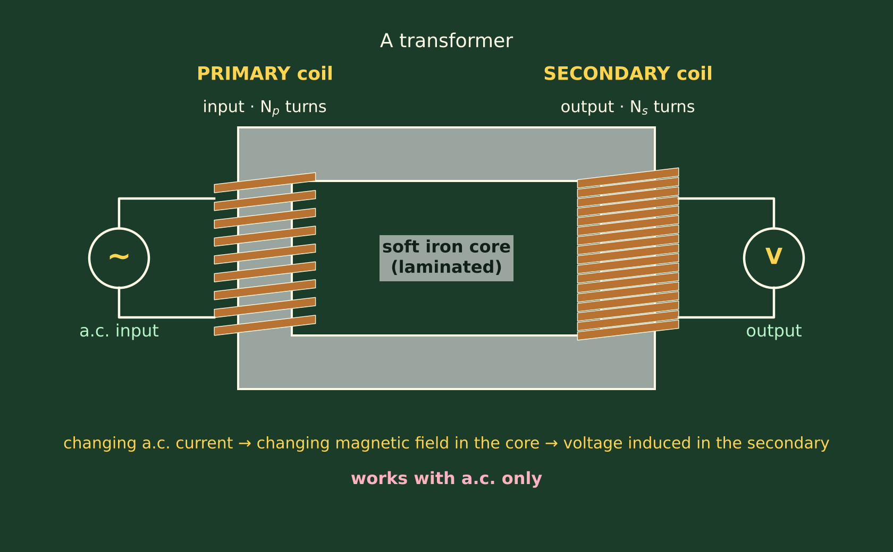
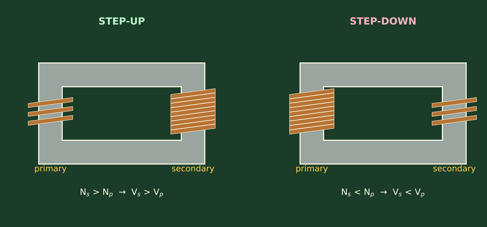
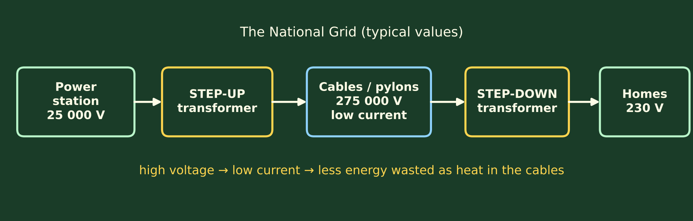

### Structure and action (7.17P)

A transformer has a **primary coil** (input), a **secondary coil** (output) and a **soft iron core** linking them. An **alternating** current in the primary makes a **changing magnetic field** in the core; this induces an alternating voltage in the secondary by electromagnetic induction. A transformer does not work with d.c. because a steady current gives an unchanging field.

*Figure 23: a transformer*

More turns on the secondary than the primary give a **step-up** transformer (voltage rises). Fewer turns on the secondary give a **step-down** transformer (voltage falls).

*Figure 24: step-up and step-down transformers*

### The National Grid (7.18P)

Power stations generate at about 25 000 V. **Step-up transformers** raise the voltage (for example to 275 000 V) for transmission. For the same power, a higher voltage means a **lower current**, so the cables heat less and **less energy is wasted**. **Step-down transformers** reduce the voltage to a safe value (230 V) near homes.

*Figure 25: transformers in the National Grid*

### Transformer calculations (7.19P, 7.20P)

Equations

<strong>Vp ÷ Vs = Np ÷ Ns</strong>  (primary voltage ÷ secondary voltage = primary turns ÷ secondary turns)<strong>Vp × Ip = Vs × Is</strong>  (input power = output power, for a 100% efficient transformer)

| **Level** | **Question** | **Full working (write it all on the board)** | **Answer** |
| --- | --- | --- | --- |
| Easy | Np = 100, Ns = 400, Vp = 6.0 V. Find Vs. | 6.0 ÷ Vs = 100 ÷ 400 → Vs = 6.0 × 400 ÷ 100 | 24 V |
| Medium | Vp = 230 V, Vs = 12 V, Np = 1150. Find Ns. | 230 ÷ 12 = 1150 ÷ Ns → Ns = 1150 × 12 ÷ 230 | 60 turns |
| Hard | 100% efficient: Vp = 230 V, Vs = 12 V, Is = 5.0 A. Find Ip. | 230 × Ip = 12 × 5.0 → Ip = 60 ÷ 230 | 0.26 A |
| J25 1PR Q5 | Vp = 25 000 V, Vs = 275 000 V, Np = 265. Find Ns. Then Is = 903 A: find Ip. | 25 000 ÷ 275 000 = 265 ÷ Ns → Ns = 275 000 × 265 ÷ 25 000 = 2915.  25 000 × Ip = 275 000 × 903 → Ip = 9933 | 2915 turns; 9930 A |

Key facts

Transformer = primary + secondary + soft iron core; a.c. only; no electrical link between coils.Step-up: more turns on the secondary. Step-down: fewer.Grid: high voltage → low current → less heating → less energy wasted; step down for safety.100% efficient: input power = output power, VpIp = VsIs. Assumption in J25 Q5b(iii): 100% efficient.

Common Mistakes

Turning the ratio upside-down. Keep primary and secondary in the same positions on both sides.Saying high voltage is used because it is faster or safer. The reason is low current and less energy wasted as heat.Saying the coils are joined by a wire. They are linked only by the magnetic field in the core.

Exam Tips

Both transformer equations are on the equation list — write the equation, substitute, rearrange, answer with a unit.‘Comment on the statement’ (J25 Q5c): primary = electromagnet making a changing field; secondary = induction; the statement is correct.For field sketches draw at least four lines, with arrows N → S, never crossing.

