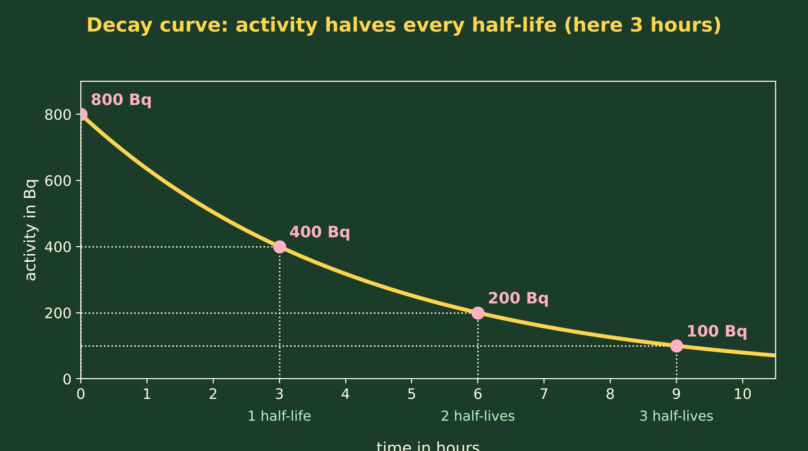

### Activity and half-life (8.11, 8.12)

The **activity** of a source is the number of decays per second, measured in **becquerels**. As nuclei decay there are fewer left, so the activity **falls over time**. The **half-life** is the **time taken for the activity (or the number of undecayed nuclei) of a sample to halve**. Never write ‘half the time’. Different isotopes have different half-lives.

*Figure 11: a decay curve — activity halves every 3 hours*

### Calculations (8.13)

Method

<strong>Step 1:</strong> number of half-lives = total time ÷ half-life.<strong>Step 2:</strong> halve the activity that many times, writing each step.<strong>Step 3:</strong> give the answer with its unit (Bq).

| **Level** | **Question** | **Full working (write it all on the board)** | **Answer** |
| --- | --- | --- | --- |
| Easy | 800 Bq, half-life 3 h. Activity after 9 h? | 9 ÷ 3 = 3 half-lives: 800 → 400 → 200 → 100 | 100 Bq |
| Medium | 240 Bq falls to 30 Bq in 1 h 30 min. Half-life? | 240 → 120 → 60 → 30 = 3 half-lives; 90 min ÷ 3 | 30 min |
| Hard | 340 counts/min incl. background 20; after 12 h 30 counts/min incl. same background. Half-life? | corrected: 320 and 10; 320 → 160 → 80 → 40 → 20 → 10 = 5 half-lives; 12 ÷ 5 | 2.4 h |

Key facts

Half-life = time taken for the activity (or number of undecayed nuclei) to halve. NOT ‘half the time’.Fraction left after n half-lives = (½)ⁿ: 1/2, 1/4, 1/8, 1/16 …Subtract background before halving.

Common Mistakes

Dividing the activity by the number of half-lives instead of halving repeatedly.Forgetting the background correction.Mixing hours and minutes.

